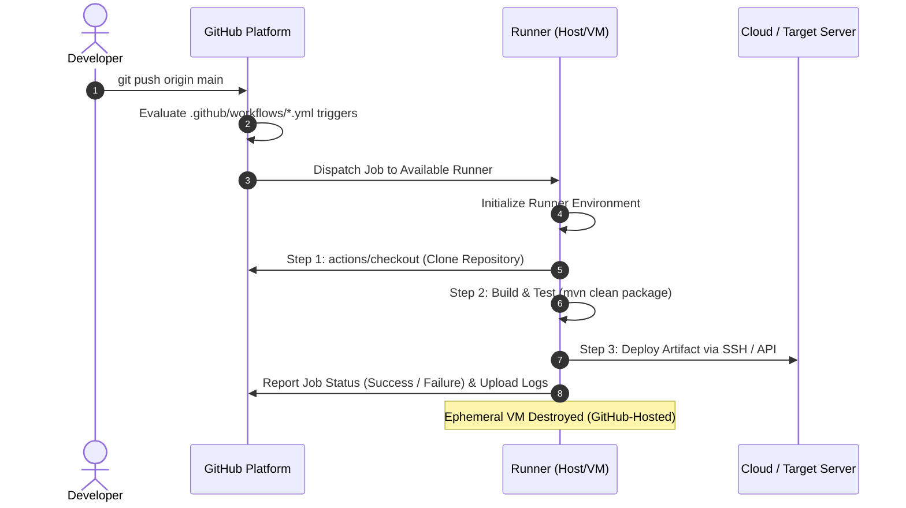
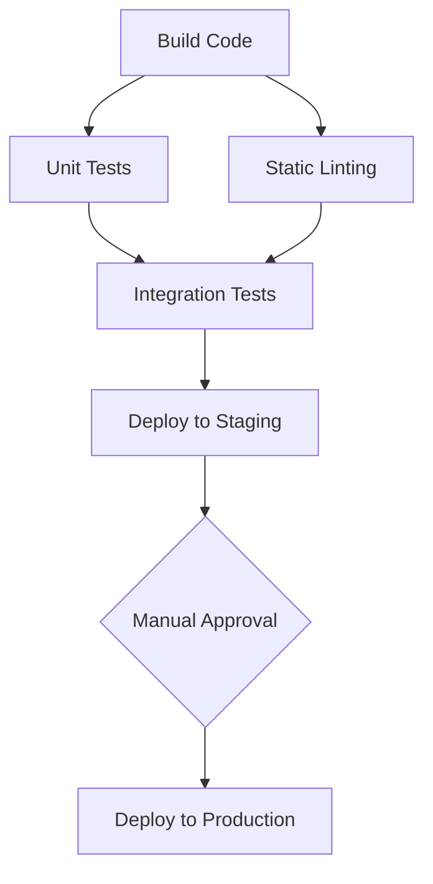

# GitHub Actions: Complete Guide, Architecture & Reference Notes

A comprehensive, production-grade reference manual covering **GitHub Actions fundamentals, architecture, YAML configuration, triggers, jobs, execution workflows, and security best practices**.

---

## Table of Contents

1. [GitHub Actions Fundamentals](#1-github-actions-fundamentals)
   - [1.1 What is GitHub Actions?](#11-what-is-github-actions)
   - [1.2 Why do we use GitHub Actions?](#12-why-do-we-use-github-actions)
   - [1.3 What is CI/CD?](#13-what-is-cicd)
   - [1.4 GitHub Actions Architecture and Workflow Execution](#14-github-actions-architecture-and-workflow-execution)
   - [1.5 What is a Workflow?](#15-what-is-a-workflow)
   - [1.6 What is a Job?](#16-what-is-a-job)
   - [1.7 What is a Step?](#17-what-is-a-step)
   - [1.8 What is an Action?](#18-what-is-an-action)
   - [1.9 What is a Runner?](#19-what-is-a-runner)
   - [1.10 GitHub-Hosted vs. Self-Hosted Runners](#110-github-hosted-vs-self-hosted-runners)
   - [1.11 GitHub Actions vs. Jenkins](#111-github-actions-vs-jenkins)
   - [1.12 GitHub Actions Lifecycle](#112-github-actions-lifecycle)
2. [Workflow and YAML Configuration](#2-workflow-and-yaml-configuration)
   - [2.1 Understanding Workflow YAML Files](#21-understanding-workflow-yaml-files)
   - [2.2 `.github/workflows` Directory Structure](#22-githubworkflows-directory-structure)
   - [2.3 Workflow Syntax and Top-Level Structure](#23-workflow-syntax-and-top-level-structure)
   - [2.4 `name`, `on`, `jobs`, `steps`, and `runs-on`](#24-name-on-jobs-steps-and-runs-on)
   - [2.5 `uses` vs. `run`](#25-uses-vs-run)
   - [2.6 `needs` Keyword (Dependencies)](#26-needs-keyword-dependencies)
   - [2.7 `if` Conditions and Status Check Functions](#27-if-conditions-and-status-check-functions)
   - [2.8 `env` Variables (Scoping & Precedence)](#28-env-variables-scoping--precedence)
   - [2.9 `defaults` and `working-directory`](#29-defaults-and-working-directory)
   - [2.10 `timeout-minutes`](#210-timeout-minutes)
   - [2.11 `continue-on-error`](#211-continue-on-error)
   - [2.12 `strategy` and `matrix`](#212-strategy-and-matrix)
   - [2.13 `fail-fast` and `max-parallel`](#213-fail-fast-and-max-parallel)
3. [Workflow Triggers and Events](#3-workflow-triggers-and-events)
   - [3.1 `push`](#31-push)
   - [3.2 `pull_request`](#32-pull_request)
   - [3.3 `workflow_dispatch` (Manual Triggers with Inputs)](#33-workflow_dispatch-manual-triggers-with-inputs)
   - [3.4 `schedule` (Cron Jobs)](#34-schedule-cron-jobs)
   - [3.5 `workflow_call` (Reusable Workflows)](#35-workflow_call-reusable-workflows)
   - [3.6 `workflow_run` (Chaining Workflows)](#36-workflow_run-chaining-workflows)
   - [3.7 `release`](#37-release)
   - [3.8 `issues`](#38-issues)
   - [3.9 `repository_dispatch` (External Webhooks)](#39-repository_dispatch-external-webhooks)
   - [3.10 Branch-Specific Triggers](#310-branch-specific-triggers)
   - [3.11 Path Filters (`paths` and `paths-ignore`)](#311-path-filters-paths-and-paths-ignore)
   - [3.12 Tag-Based Triggers](#312-tag-based-triggers)
   - [3.13 Manual vs. Automatic Workflow Execution](#313-manual-vs-automatic-workflow-execution)
4. [Jobs, Steps and Execution](#4-jobs-steps-and-execution)
   - [4.1 Job Dependencies (DAGs)](#41-job-dependencies-dags)
   - [4.2 Parallel Job Execution](#42-parallel-job-execution)
   - [4.3 Sequential Job Execution](#43-sequential-job-execution)
   - [4.4 Step Outputs (`$GITHUB_OUTPUT`)](#44-step-outputs-github_output)
   - [4.5 Job Outputs](#45-job-outputs)
   - [4.6 Passing Data Between Jobs (`upload-artifact` & `download-artifact`)](#46-passing-data-between-jobs-upload-artifact--download-artifact)
   - [4.7 Conditional Job Execution](#47-conditional-job-execution)
   - [4.8 Job-Level vs. Step-Level Environment Variables](#48-job-level-vs-step-level-environment-variables)
   - [4.9 Reusable Workflows (`workflow_call`)](#49-reusable-workflows-workflow_call)
   - [4.10 Composite Actions](#410-composite-actions)
   - [4.11 Custom Actions (JavaScript, Docker, Composite)](#411-custom-actions-javascript-docker-composite)
   - [4.12 Local Actions (In-Repo Actions)](#412-local-actions-in-repo-actions)
5. [Secrets and Security](#5-secrets-and-security)
   - [5.1 What are GitHub Secrets?](#51-what-are-github-secrets)
   - [5.2 Repository Secrets](#52-repository-secrets)
   - [5.3 Environment Secrets](#53-environment-secrets)
   - [5.4 Organization Secrets](#54-organization-secrets)
   - [5.5 GitHub Variables (`vars`) vs. Secrets (`secrets`)](#55-github-variables-vars-vs-secrets-secrets)
   - [5.6 Using Secrets in YAML](#56-using-secrets-in-yaml)
   - [5.7 Secret Masking in Execution Logs](#57-secret-masking-in-execution-logs)
   - [5.8 GitHub Actions Permissions Principle](#58-github-actions-permissions-principle)
   - [5.9 The Automatic `GITHUB_TOKEN`](#59-the-automatic-github_token)
   - [5.10 Fine-Grained Permissions Syntax](#510-fine-grained-permissions-syntax)
   - [5.11 AWS Authentication via OIDC (OpenID Connect)](#511-aws-authentication-via-oidc-openid-connect)
   - [5.12 Secure Server Deployments Using SSH Keys](#512-secure-server-deployments-using-ssh-keys)
   - [5.13 Preventing Secret Exposure in Console Logs](#513-preventing-secret-exposure-in-console-logs)
   - [5.14 Dependency & Supply-Chain Security (Action Pinning)](#514-dependency--supply-chain-security-action-pinning)

---

## 1. GitHub Actions Fundamentals

### 1.1 What is GitHub Actions?
**GitHub Actions** is a continuous integration, continuous delivery (CI/CD), and general event-driven automation platform built directly into GitHub. It enables engineering teams to automate software development workflows directly within their repositories—from code compilation, automated testing, and security scanning to artifact publishing and multi-cloud production deployments.

Because it is native to GitHub, any platform event (such as a commit push, pull request creation, issue label, release tag, or scheduled cron time) can automatically trigger an execution pipeline.

---

### 1.2 Why do we use GitHub Actions?
1. **Zero Infrastructure Overhead:** With GitHub-hosted runners, teams do not need to install, patch, or maintain build servers or master nodes.
2. **Native GitHub Integration:** Authentication, pull request status checks, commit status badges, and deployment environments are tightly coupled with the code repository.
3. **Rich Marketplace Ecosystem:** Over 20,000+ pre-built, community-maintained, and official vendor actions (e.g., `actions/checkout`, `aws-actions`, `docker/build-push-action`, `sonarsource/sonarcloud-github-action`) eliminate boilerplate scripting.
4. **Matrix Builds:** Easily test code across combinations of operating systems (Ubuntu, Windows, macOS) and runtime versions (Java 11, 17, 21; Node.js 18, 20) with minimal YAML syntax.
5. **Security & Secrets Governance:** Integrated credential masking, OIDC cloud federation (AWS, Azure, GCP), and environment protection rules with required approvers.
6. **Cost Effectiveness:** Generous free minutes for public repositories and bundled allocations for private enterprise plans.

---

### 1.3 What is CI/CD?
- **CI (Continuous Integration):** The automated practice where developers frequently merge code changes into a central repository branch. Every commit or pull request automatically triggers automated builds, linters, unit tests, and static security scans (e.g., SonarQube) to catch integration bugs early (*"Shift-Left"*).
- **CD (Continuous Delivery):** Ensures that code in the main branch is always in a deployable, release-ready state. Build artifacts (e.g., Docker images, WAR/JAR files) are automatically built, tested, packaged, and published to artifact repositories (such as Sonatype Nexus, Amazon ECR). Deployment to non-production environments (Dev, QA, Staging) is automated, while deployment to Production requires a manual approval step.
- **CD (Continuous Deployment):** An extension of Continuous Delivery where every change that passes all stages of the production pipeline is released directly to customers without human intervention.

---

### 1.4 GitHub Actions Architecture and Workflow Execution

```
+--------------------------------------------------------------------------------+
|                                GitHub Platform                                 |
|                                                                                |
|  [Repository Event] (push, pull_request, schedule, workflow_dispatch)          |
|         |                                                                      |
|         v                                                                      |
|  [Workflow Engine] reads .github/workflows/*.yml                               |
|         |                                                                      |
|         v                                                                      |
|  [Job Scheduler] resolves dependencies ('needs') & creates execution graph     |
+---------+----------------------------------------------------+-----------------+
          |                                                    |
          v HTTPS (Long Poll / Queue)                          v HTTPS (Long Poll)
+-----------------------------------+        +-----------------------------------+
|       GitHub-Hosted Runner        |        |        Self-Hosted Runner         |
|  (Azure Cloud Ephemeral VM)       |        |   (Private AWS EC2 / On-Prem VM)  |
|                                   |        |                                   |
|  +-----------------------------+  |        |  +-----------------------------+  |
|  | Runner Service (Listener)   |  |        |  | Runner Daemon (svc.sh)      |  |
|  +--------------+--------------+  |        |  +--------------+--------------+  |
|                 |                 |        |                 |                 |
|  +--------------v--------------+  |        |  +--------------v--------------+  |
|  | Job Workspace:              |  |        |  | Private Workspace:          |  |
|  |  - Step 1: actions/checkout |  |        |  |  - Step 1: actions/checkout |  |
|  |  - Step 2: setup-java (JDK) |  |        |  |  - Step 2: Run Custom VPN   |  |
|  |  - Step 3: mvn clean package|  |        |  |  - Step 3: Deploy to Internal| |
|  +-----------------------------+  |        |  +-----------------------------+  |
+-----------------+-----------------+        +-----------------+-----------------+
                  |                                            |
                  +--------------------+-----------------------+
                                       | HTTPS (Encrypted)
                                       v
                     +-----------------------------------+
                     | GitHub UI, Check Runs & Logs      |
                     +-----------------------------------+
```

**How execution flows:**
1. **Trigger Event:** An event occurs in GitHub (e.g., a developer pushes code to `main`).
2. **Workflow Parser:** GitHub searches `.github/workflows/` for workflows whose `on:` triggers match the event.
3. **Queue & Runner Assignment:** Jobs are queued. GitHub identifies available runners matching the `runs-on:` label (`ubuntu-latest` or `self-hosted`).
4. **Step Execution:** The runner executes steps in sequence inside an isolated workspace directory (`$GITHUB_WORKSPACE`).
5. **Status & Logs:** Runner streams console stdout/stderr logs live back to GitHub over encrypted HTTPS.
6. **Teardown:** Hosted VMs are immediately destroyed. Artifacts and logs are preserved in GitHub storage.

---

### 1.5 What is a Workflow?
A **Workflow** is an automated, configurable process composed of one or more jobs. It is defined as a YAML file stored in the `.github/workflows/` directory in the repository. A repository can have multiple workflows (e.g., `ci.yml` for pull requests, `deploy.yml` for releases, `cleanup.yml` for nightly cron tasks).

---

### 1.6 What is a Job?
A **Job** is a collection of steps that execute sequentially on the same runner instance.
- By default, multiple jobs within a workflow run **in parallel**.
- You can create sequential job execution or directed acyclic graphs (DAGs) using the `needs:` keyword.
- If a job fails, subsequent dependent jobs are skipped unless configured with conditional status checks (e.g., `if: always()`).

---

### 1.7 What is a Step?
A **Step** is an individual task executed inside a job. Steps within the same job execute sequentially in the exact order declared. Because they run on the same runner machine:
- Steps share the filesystem (files created in Step 1 are accessible to Step 2).
- Steps can run shell commands (`run:`) or execute reusable packaged actions (`uses:`).

---

### 1.8 What is an Action?
An **Action** is the smallest standalone, reusable execution block in GitHub Actions. Instead of writing custom bash scripts for common tasks, you reference pre-built actions:
- `actions/checkout@v4`: Checks out your git repository into the workspace.
- `actions/setup-java@v4`: Downloads, installs, and configures the JDK runtime.
- `docker/build-push-action@v5`: Builds and pushes Docker images to a registry.

Actions can be implemented as **JavaScript Actions**, **Docker Container Actions**, or **Composite Actions**.

---

### 1.9 What is a Runner?
A **Runner** is a server application that listens for available jobs from GitHub Actions, executes the assigned job steps, and streams output logs back to GitHub. Runners can be:
- **GitHub-hosted:** Managed entirely by GitHub in Azure cloud.
- **Self-hosted:** Managed, maintained, and secured on your own infrastructure (AWS EC2, Google Cloud Compute, Kubernetes, on-premises).

---

### 1.10 GitHub-Hosted vs. Self-Hosted Runners

| Feature | GitHub-Hosted Runners | Self-Hosted Runners |
| :--- | :--- | :--- |
| **Management** | Fully managed, updated, and patched by GitHub. | Managed, secured, and updated by your DevOps team. |
| **Clean Environment** | **Ephemeral:** Every job starts in a pristine, isolated VM that is destroyed after completion. | **Persistent:** Filesystem remains between jobs unless explicitly cleaned or containerized. |
| **Network & Firewall** | Public cloud IPs. Cannot access private VPCs without reverse proxies or VPNs. | Sits inside your private cloud VPC (AWS, GCP) with direct access to private DBs, Nexus, and EC2. |
| **Custom Hardware** | Standard fixed sizes (2-core, 4-core, etc.). | Any compute spec (64-core CPU, 256GB RAM, GPU instances, custom storage). |
| **Pre-installed Software** | Massive catalog of tools (Docker, Node, Java, Python, Android SDK). | You must pre-install your required tools (Maven, JDK, Docker, CLI utilities). |
| **Pricing** | Billed by execution minutes (after free plan quota). | Runner software is free; you pay for underlying server infrastructure. |
| **Security Risk for Public Repos** | None (ephemeral VM). | **High risk** if used on public repositories (arbitrary PR code can compromise your internal network). |

---

### 1.11 GitHub Actions vs. Jenkins

| Feature | GitHub Actions | Jenkins |
| :--- | :--- | :--- |
| **Architecture** | Modern cloud-native SaaS (Hybrid with self-hosted). | Master-Agent (Controller-Agent) client-server architecture. |
| **Hosting & Infrastructure** | Zero setup; cloud-hosted by GitHub. | Self-hosted; requires provisioning and maintaining servers, Java runtimes, and storage. |
| **Configuration** | YAML files in `.github/workflows/`. | `Jenkinsfile` (Groovy Scripted or Declarative syntax). |
| **Extensibility** | GitHub Marketplace Actions (packaged, versioned). | Jenkins Plugins (historically prone to plugin dependency hell and security CVEs). |
| **Maintenance** | Minimal; no master node updates or database backups. | High; controller OS patching, plugin updates, disk space management, backup restores. |
| **GitHub Integration** | 100% native; checks, environments, PR comments. | Requires webhooks, GitHub plugins, and OAuth token credentials. |
| **Learning Curve** | Low to moderate (YAML based). | Steep (Groovy pipeline syntax, controller administration). |

---

### 1.12 GitHub Actions Lifecycle



1. **Trigger:** Event occurs (e.g., code push or webhook).
2. **Evaluation:** GitHub filters matching workflows based on branch, tag, and path rules.
3. **Queueing:** Workflow jobs are converted into an execution plan and placed in the runner queue.
4. **Provisioning:** A runner claims the job and prepares the workspace.
5. **Execution:** Runner iterates through steps: downloading actions, executing scripts, setting environment variables.
6. **Teardown & Reporting:** Status check is updated on the commit/PR. Hosted runner VM is destroyed.

---

## 2. Workflow and YAML Configuration

### 2.1 Understanding Workflow YAML Files
Workflows are written in standard **YAML (YAML Ain't Markup Language)**.
- Uses **two-space indentation** (tabs are forbidden).
- Case-sensitive keys.
- Supports strings, lists (`- item`), dictionaries (`key: value`), and multiline strings:
  - `|` (literal block scalar): preserves newlines (ideal for multiline bash scripts).
  - `>` (folded block scalar): converts newlines into spaces.

---

### 2.2 `.github/workflows` Directory Structure
All workflow files must be placed directly inside `.github/workflows/` at the root of the repository:

```
my-java-project/
├── .github/
│   ├── actions/                  # Optional: local custom actions
│   │   └── deploy-tomcat/
│   │       └── action.yml
│   └── workflows/                # All workflow YAML definitions
│       ├── build-test.yml        # PR verification workflow
│       ├── deploy.yml            # Main branch deployment workflow
│       ├── nightly-security.yml  # Scheduled cron vulnerability scan
│       └── release.yml           # Tag-triggered release workflow
├── src/
├── pom.xml
└── README.md
```

---

### 2.3 Workflow Syntax and Top-Level Structure

```yaml
name: Production CI/CD Pipeline          # Display name in the GitHub UI
run-name: Deploy to Prod by @${{ github.actor }} # Dynamic run title

on:                                      # Events that trigger the workflow
  push:
    branches: [ main ]
  workflow_dispatch:                     # Allows manual execution

permissions:                             # Least-privilege permissions
  contents: read
  id-token: write

env:                                     # Global environment variables
  APPLICATION_NAME: task-manager
  JAVA_VERSION: '17'

defaults:
  run:
    shell: bash

jobs:
  build:
    name: Build & Test Application
    runs-on: ubuntu-latest
    steps:
      - uses: actions/checkout@v4
      - name: Run Build
        run: echo "Building $APPLICATION_NAME"
```

---

### 2.4 `name`, `on`, `jobs`, `steps`, and `runs-on`
- **`name`:** Optional friendly name shown in the GitHub Actions tab.
- **`on`:** Mandatory trigger block defining when the workflow runs.
- **`jobs`:** Mandatory map of one or more jobs to execute.
- **`runs-on`:** Specifies the operating system runner for the job (`ubuntu-latest`, `ubuntu-22.04`, `windows-latest`, `macos-latest`, or `self-hosted`).
- **`steps`:** List of executable commands or actions inside the job.

---

### 2.5 `uses` vs. `run`
- **`uses:`** Executes a packaged action published in GitHub Marketplace, a public/private repo, or a local directory.
  ```yaml
  - name: Checkout Code
    uses: actions/checkout@v4
  ```
- **`run:`** Executes raw command-line programs or shell scripts on the runner OS.
  ```yaml
  - name: Compile Code
    run: |
      mvn clean compile
      mvn test-compile
  ```

---

### 2.6 `needs` Keyword (Dependencies)
By default, all jobs in a workflow execute **concurrently**. The `needs:` keyword defines explicit dependencies, enforcing sequential ordering or directed acyclic graphs:

```yaml
jobs:
  lint:
    runs-on: ubuntu-latest
    steps:
      - run: echo "Running Linter..."

  test:
    runs-on: ubuntu-latest
    steps:
      - run: echo "Running Unit Tests..."

  build:
    needs: [lint, test]                  # Runs only after BOTH lint and test succeed
    runs-on: ubuntu-latest
    steps:
      - run: echo "Packaging Binary..."

  deploy:
    needs: build                         # Runs only after build succeeds
    runs-on: ubuntu-latest
    steps:
      - run: echo "Deploying to Production..."
```

---

### 2.7 `if` Conditions and Status Check Functions
The `if` keyword allows conditional execution of steps or entire jobs based on expressions:

```yaml
steps:
  - name: Run on Main Branch Only
    if: github.ref == 'refs/heads/main'
    run: ./deploy-prod.sh

  - name: Run on Failure
    if: failure()                        # Executes only if a previous step failed
    run: ./send-slack-alert.sh --status "failed"

  - name: Always Run Cleanup
    if: always()                         # Executes regardless of success or failure
    run: rm -rf /tmp/build-cache
```

**Built-in Status Check Functions:**
- `success()`: True if all previous steps succeeded (default behavior).
- `failure()`: True if any previous step in the job failed.
- `always()`: Always evaluates to true, even if cancelled.
- `cancelled()`: True if the workflow run was manually cancelled.

---

### 2.8 `env` Variables (Scoping & Precedence)
Environment variables can be defined at three scopes:

```yaml
env:
  SCOPE: "I am Workflow-Level"           # 1. Workflow Scope

jobs:
  demo:
    runs-on: ubuntu-latest
    env:
      SCOPE: "I am Job-Level"            # 2. Job Scope (Overrides Workflow)
    steps:
      - name: Print Step Variable
        env:
          SCOPE: "I am Step-Level"       # 3. Step Scope (Overrides Job & Workflow)
        run: echo "Current Scope: $SCOPE" # Outputs: "I am Step-Level"

      - name: Print Job Variable
        run: echo "Current Scope: $SCOPE" # Outputs: "I am Job-Level"
```

**Precedence Order:** Step Level > Job Level > Workflow Level.

---

### 2.9 `defaults` and `working-directory`
Use `defaults.run` to eliminate repetition across steps:

```yaml
defaults:
  run:
    shell: bash                          # Enforce bash shell across all steps
    working-directory: ./src/backend     # Execute all 'run' steps in this sub-folder

jobs:
  build:
    runs-on: ubuntu-latest
    steps:
      - uses: actions/checkout@v4
      - run: mvn clean compile           # Automatically runs inside ./src/backend using bash
```

---

### 2.10 `timeout-minutes`
Prevents runaway, stuck, or hanging jobs from consuming all your included GitHub Actions minutes or blocking runners:

```yaml
jobs:
  integration_test:
    runs-on: ubuntu-latest
    timeout-minutes: 15                  # Kills the job if it exceeds 15 minutes (Default is 360)
    steps:
      - run: ./run-e2e-tests.sh
```

---

### 2.11 `continue-on-error`
Allows a step or job to fail without causing the overall workflow run to fail. Useful for experimental unit tests, non-critical linters, or informational security scans:

```yaml
steps:
  - name: Run Non-Critical Linting
    continue-on-error: true              # If this step exits with code 1, step turns orange, but job continues
    run: npm run lint:loose

  - name: Critical Step
    run: npm run build
```

---

### 2.12 `strategy` and `matrix`
A **Matrix** executes the same job across multiple variations of operating systems, language versions, and configurations:

```yaml
jobs:
  test_matrix:
    runs-on: ${{ matrix.os }}
    strategy:
      matrix:
        os: [ubuntu-latest, windows-latest]
        java-version: ['17', '21']
        include:
          - os: ubuntu-latest
            java-version: '21'
            experimental: true
        exclude:
          - os: windows-latest
            java-version: '17'
    steps:
      - uses: actions/checkout@v4
      - uses: actions/setup-java@v4
        with:
          distribution: 'temurin'
          java-version: ${{ matrix.java-version }}
      - run: mvn test
```

---

### 2.13 `fail-fast` and `max-parallel`
- **`fail-fast: true` (Default):** If any single job in the matrix fails, GitHub immediately cancels all other currently executing matrix jobs.
- **`fail-fast: false`:** Ensures all matrix jobs run to completion regardless of failures, providing a complete test report across all OS/Java versions.
- **`max-parallel`:** Limits the number of matrix jobs that run concurrently:

```yaml
strategy:
  fail-fast: false
  max-parallel: 2                        # Runs a maximum of 2 jobs at a time
  matrix:
    node: [16, 18, 20, 22]
```

---

## 3. Workflow Triggers and Events

### 3.1 `push`
Fires when commits are pushed directly to a branch or merged via pull request:

```yaml
on:
  push:
    branches:
      - main
      - 'release/**'                     # Matches release/1.0, release/2.0
```

---

### 3.2 `pull_request`
Fires on pull request activities. By default, it triggers on `opened`, `synchronize` (new commits pushed to PR), and `reopened`:

```yaml
on:
  pull_request:
    types: [opened, synchronize, reopened, closed]
    branches:
      - main
```

---

### 3.3 `workflow_dispatch` (Manual Triggers with Inputs)
Enables running workflows manually from the GitHub UI or via the GitHub CLI (`gh workflow run`) with custom inputs:

```yaml
on:
  workflow_dispatch:
    inputs:
      environment:
        description: 'Target Environment'
        required: true
        default: 'staging'
        type: choice
        options:
          - dev
          - staging
          - production
      deploy_debug:
        description: 'Enable Debug Logging'
        required: false
        type: boolean
        default: false

jobs:
  manual_deploy:
    runs-on: ubuntu-latest
    steps:
      - run: |
          echo "Deploying to: ${{ inputs.environment }}"
          echo "Debug mode: ${{ inputs.deploy_debug }}"
```

---

### 3.4 `schedule` (Cron Jobs)
Triggers workflows on recurring schedules using standard POSIX cron syntax (evaluated in **UTC** time):

```yaml
on:
  schedule:
    # Runs at 02:00 UTC every weekday (Monday through Friday)
    # ┌───────────── minute (0 - 59)
    # │ ┌───────────── hour (0 - 23)
    # │ │ ┌───────────── day of the month (1 - 31)
    # │ │ │ ┌───────────── month (1 - 12)
    # │ │ │ │ ┌───────────── day of the week (0 - 6, Sunday to Saturday)
    - cron: '0 2 * * 1-5'
```

---

### 3.5 `workflow_call` (Reusable Workflows)
Defines a workflow that can be called by other workflows across the repository or organization:

```yaml
on:
  workflow_call:
    inputs:
      config-path:
        required: true
        type: string
    secrets:
      AUTH_TOKEN:
        required: true
```

---

### 3.6 `workflow_run` (Chaining Workflows)
Allows triggering a workflow when a completely different workflow finishes:

```yaml
on:
  workflow_run:
    workflows: ["Build and Test"]        # Name of upstream workflow
    types:
      - completed
    branches:
      - main

jobs:
  on_success_notification:
    runs-on: ubuntu-latest
    if: ${{ github.event.workflow_run.conclusion == 'success' }}
    steps:
      - run: echo "Upstream workflow succeeded! Triggering post-deployment tasks..."
```

---

### 3.7 `release`
Fires when GitHub releases are created or published:

```yaml
on:
  release:
    types: [published, created]
```

---

### 3.8 `issues`
Enables workflow automation when issues are created, labeled, or modified:

```yaml
on:
  issues:
    types: [opened, labeled, assigned]

jobs:
  auto_triage:
    runs-on: ubuntu-latest
    steps:
      - run: echo "Issue #${{ github.event.issue.number }} opened by ${{ github.actor }}"
```

---

### 3.9 `repository_dispatch` (External Webhooks)
Allows external systems (e.g., Jira, ServiceNow, AWS Lambda, monitoring webhooks) to trigger a workflow via the GitHub REST API:

```yaml
on:
  repository_dispatch:
    types: [deploy_webhook_event]

jobs:
  webhook_job:
    runs-on: ubuntu-latest
    steps:
      - run: echo "Payload client_payload: ${{ github.event.client_payload.version }}"
```

---

### 3.10 Branch-Specific Triggers
Include or exclude branches using exact names, wildcards, or regex patterns:

```yaml
on:
  push:
    branches:
      - main
      - 'feature/*'                      # Matches feature/login (1 level deep)
      - 'feature/**'                     # Matches feature/user/auth (recursive)
    branches-ignore:
      - 'experimental/**'
```

---

### 3.11 Path Filters (`paths` and `paths-ignore`)
Prevents running expensive CI builds when changes do not affect executable code:

```yaml
on:
  push:
    paths:
      - 'src/**'
      - 'pom.xml'
    paths-ignore:
      - '**.md'                          # Never run on documentation updates
      - 'docs/**'
      - '.gitignore'
```

---

### 3.12 Tag-Based Triggers
Triggers jobs specifically when git tags are created (e.g., for semantic version releases):

```yaml
on:
  push:
    tags:
      - 'v*.*.*'                         # Matches v1.0.0, v2.3.4
      - '!v*-beta'                       # Excludes beta tags
```

---

### 3.13 Manual vs. Automatic Workflow Execution

| Aspect | Automatic Execution (`push`, `pull_request`, `schedule`) | Manual Execution (`workflow_dispatch`, `repository_dispatch`) |
| :--- | :--- | :--- |
| **Trigger Source** | Code commits, PR reviews, git tags, clock timer. | User action in GitHub UI, GitHub CLI, or external REST API call. |
| **Inputs** | No dynamic human inputs; uses commit payload. | Accepts dynamic form inputs (string, boolean, environment choices). |
| **Typical Use Case** | Continuous Integration, unit testing, nightly security scans. | Emergency hotfixes, manual production deployments, rollbacks, on-demand DB migrations. |

---

## 4. Jobs, Steps and Execution

### 4.1 Job Dependencies (DAGs)
GitHub Actions supports Directed Acyclic Graphs (DAGs) to model complex pipeline workflows:



---

### 4.2 Parallel Job Execution
Jobs without `needs:` run simultaneously as long as runner capacity is available:

```yaml
jobs:
  frontend_tests:
    runs-on: ubuntu-latest
    steps:
      - run: npm test

  backend_tests:
    runs-on: ubuntu-latest
    steps:
      - run: mvn test
```

---

### 4.3 Sequential Job Execution
Jobs chained with `needs:` enforce an orderly sequence:

```yaml
jobs:
  job_a:
    runs-on: ubuntu-latest
    steps: [run: ./step-a.sh]

  job_b:
    needs: job_a
    runs-on: ubuntu-latest
    steps: [run: ./step-b.sh]

  job_c:
    needs: job_b
    runs-on: ubuntu-latest
    steps: [run: ./step-c.sh]
```

---

### 4.4 Step Outputs (`$GITHUB_OUTPUT`)
Steps output data by appending key-value pairs to the special environment file `$GITHUB_OUTPUT`:

```yaml
steps:
  - name: Calculate App Version
    id: versioning                       # id is required to reference outputs later
    run: |
      APP_VER="1.0.$(date +%s)"
      echo "version=$APP_VER" >> "$GITHUB_OUTPUT"
      echo "release_date=$(date +%Y-%m-%d)" >> "$GITHUB_OUTPUT"

  - name: Use Previous Step Output
    run: |
      echo "Generated Version: ${{ steps.versioning.outputs.version }}"
      echo "Release Date: ${{ steps.versioning.outputs.release_date }}"
```

---

### 4.5 Job Outputs
To expose a step's output to downstream jobs, declare it in the `jobs.<job_id>.outputs` mapping:

```yaml
jobs:
  generate_tag:
    runs-on: ubuntu-latest
    outputs:
      release_tag: ${{ steps.tag_step.outputs.tag }}
    steps:
      - id: tag_step
        run: echo "tag=v2026.10" >> "$GITHUB_OUTPUT"

  deploy:
    needs: generate_tag
    runs-on: ubuntu-latest
    steps:
      - name: Read Upstream Output
        run: echo "Deploying tag: ${{ needs.generate_tag.outputs.release_tag }}"
```

---

### 4.6 Passing Data Between Jobs (`upload-artifact` & `download-artifact`)
Because each job runs on an isolated runner VM with an independent filesystem, use official artifact actions to persist and share compiled binaries:

```yaml
jobs:
  build:
    runs-on: ubuntu-latest
    steps:
      - uses: actions/checkout@v4
      - run: mvn clean package
      - name: Upload WAR Artifact
        uses: actions/upload-artifact@v4
        with:
          name: task-manager-war
          path: target/task-manager.war
          retention-days: 7

  deploy:
    needs: build
    runs-on: ubuntu-latest
    steps:
      - name: Download Artifact
        uses: actions/download-artifact@v4
        with:
          name: task-manager-war
          path: ./dist
      - run: ls -lh ./dist/task-manager.war
```

---

### 4.7 Conditional Job Execution
Jobs can evaluate conditions before execution starts:

```yaml
jobs:
  deploy_production:
    if: github.ref == 'refs/heads/main' && github.event_name == 'push'
    runs-on: ubuntu-latest
    steps:
      - run: ./deploy-prod.sh
```

---

### 4.8 Job-Level vs. Step-Level Environment Variables
- **Job-Level `env`:** Available to every single step inside that specific job.
- **Step-Level `env`:** Scoped exclusively to that individual step. Ideal for injecting sensitive tokens only into the command that requires them:

```yaml
jobs:
  build:
    runs-on: ubuntu-latest
    env:
      BUILD_MODE: "production"           # Visible to all steps below
    steps:
      - name: Step with Specific Secret
        env:
          API_KEY: ${{ secrets.PROD_API_KEY }} # Visible ONLY in this step
        run: ./upload.sh --key "$API_KEY"
```

---

### 4.9 Reusable Workflows (`workflow_call`)
Allows centralizing standard workflows (e.g., standard Maven build + Sonar scan) across hundreds of repositories.

**Caller Workflow (`.github/workflows/caller.yml`):**
```yaml
name: Application CI

on:
  push:
    branches: [ main ]

jobs:
  call_shared_pipeline:
    uses: my-org/shared-workflows/.github/workflows/maven-ci.yml@v1.2.0
    with:
      java-version: '17'
      enable-sonar: true
    secrets:
      SONAR_TOKEN: ${{ secrets.SONAR_TOKEN }}
```

---

### 4.10 Composite Actions
A **Composite Action** packages multiple workflow steps into a single reusable action file (`action.yml`). It runs directly on the calling runner without spinning up a separate container:

```yaml
# .github/actions/setup-build-env/action.yml
name: 'Setup Build Environment'
description: 'Configures Java, Maven cache, and prints environment info'
inputs:
  java-version:
    description: 'Java JDK version'
    required: true
    default: '17'

runs:
  using: 'composite'
  steps:
    - name: Setup Java JDK
      uses: actions/setup-java@v4
      with:
        distribution: 'temurin'
        java-version: ${{ inputs.java-version }}
        cache: 'maven'
      shell: bash

    - name: Verify Versions
      run: |
        java -version
        mvn -version
      shell: bash
```

In your main workflow:
```yaml
steps:
  - uses: actions/checkout@v4
  - name: Run Composite Action
    uses: ./.github/actions/setup-build-env
    with:
      java-version: '17'
```

---

### 4.11 Custom Actions (JavaScript, Docker, Composite)

| Type | How It Runs | Speed | Portability | Best For |
| :--- | :--- | :--- | :--- | :--- |
| **Composite Action** | Executes steps directly on runner shell. | Fast (no container setup). | Bound to runner OS. | Bundling common setup steps or bash scripts. |
| **JavaScript Action** | Runs directly via Node.js runtime on runner. | Fastest execution. | Cross-platform (Linux, Windows, macOS). | Logic-heavy integrations, API calls, GitHub REST API automation. |
| **Docker Action** | Runs inside an isolated container built from Dockerfile. | Slower (requires container build/pull). | High (runs identical on any Linux runner). | Toolchains requiring exact Linux OS packages or custom binaries. |

---

### 4.12 Local Actions (In-Repo Actions)
You do not have to publish an action to the GitHub Marketplace to use it. You can reference local repository paths:

```yaml
steps:
  - uses: actions/checkout@v4
  - name: Run Local Action
    uses: ./.github/actions/my-custom-deployer
    with:
      deploy-target: 'production'
```

---

## 5. Secrets and Security

### 5.1 What are GitHub Secrets?
**GitHub Secrets** are encrypted environment variables stored within GitHub. They protect sensitive information—such as database passwords, API tokens, SSH private keys, and cloud credentials.
- Secrets are encrypted using Libsodium sealed boxes before being stored.
- Once created, secret values **cannot be read in plain text** by anyone via the UI or API.

---

### 5.2 Repository Secrets
- Scoped strictly to a single repository.
- Configured under: **Repository Settings** -> **Secrets and variables** -> **Actions**.
- Accessible only by workflows running within that specific repository.

---

### 5.3 Environment Secrets
- Scoped to specific **GitHub Environments** (e.g., `Development`, `Staging`, `Production`).
- Allow different values for the same secret name across stages (e.g., `DATABASE_URL` can point to dev in `Development` and RDS cluster in `Production`).
- Work in tandem with **Environment Protection Rules** (e.g., required approvals from lead engineers before production secrets can be decrypted).

```yaml
jobs:
  deploy_prod:
    runs-on: ubuntu-latest
    environment: Production              # Unlocks Production environment secrets
    steps:
      - run: ./deploy.sh --db-url "${{ secrets.DATABASE_URL }}"
```

---

### 5.4 Organization Secrets
- Defined at the GitHub Organization level.
- Shared across multiple repositories without duplicate manual entry.
- Access policies can restrict secrets to:
  - All repositories
  - Private repositories only
  - An explicitly selected whitelist of repositories

---

### 5.5 GitHub Variables (`vars`) vs. Secrets (`secrets`)

| Feature | GitHub Variables (`vars`) | GitHub Secrets (`secrets`) |
| :--- | :--- | :--- |
| **Encryption** | Stored in plain text. | Encrypted at rest using Libsodium. |
| **Visibility** | Value visible in Settings UI and logs. | Masked with `***` in execution logs; hidden in UI. |
| **Use Case** | Non-sensitive configs (`PORT`, `REGION`, `APP_ENV`). | Sensitive credentials (`SSH_KEY`, `DB_PASSWORD`, `API_TOKEN`). |
| **Access Syntax** | `${{ vars.AWS_REGION }}` | `${{ secrets.AWS_SECRET_ACCESS_KEY }}` |

---

### 5.6 Using Secrets in YAML
Inject secrets as environment variables inside steps:

```yaml
steps:
  - name: Deploy with Token
    env:
      NEXUS_PASSWORD: ${{ secrets.NEXUS_DEPLOY_TOKEN }}
    run: |
      mvn deploy -Dnexus.password="$NEXUS_PASSWORD"
```

---

### 5.7 Secret Masking in Execution Logs
GitHub automatically intercepts log streams and replaces any string matching a known secret value with asterisks: `***`.

**Important Limitations to Keep in Mind:**
- Secrets shorter than 4 characters are **not** masked.
- If a secret is transformed (e.g., URI-encoded or base64-encoded) inside a custom script, GitHub's pattern matcher may not recognize the transformed string and it may leak into console output in plain text.

---

### 5.8 GitHub Actions Permissions Principle
Workflows should always follow the **Principle of Least Privilege**. By default, enterprise repositories should set the base `GITHUB_TOKEN` permissions to read-only, explicitly granting write privileges only to the jobs that require them.

---

### 5.9 The Automatic `GITHUB_TOKEN`
At the start of every workflow run, GitHub automatically generates a unique JSON Web Token (JWT) called `GITHUB_TOKEN`:
- Injected automatically into the runner context.
- Accessible via `${{ secrets.GITHUB_TOKEN }}`.
- Expires automatically as soon as the workflow run finishes.
- Used to authenticate against the GitHub API (e.g., creating releases, commenting on PRs, pushing docker images to GitHub Container Registry `ghcr.io`).

---

### 5.10 Fine-Grained Permissions Syntax
Explicitly control what the `GITHUB_TOKEN` can access at the workflow or job level:

```yaml
permissions:
  contents: read                         # Read repository code
  pull-requests: write                   # Post comments on PRs
  issues: write                          # Label or close issues
  packages: write                        # Publish to ghcr.io
  id-token: write                        # Required for AWS OIDC authentication
```

---

### 5.11 AWS Authentication via OIDC (OpenID Connect)
Instead of storing permanent, long-lived AWS IAM access keys (`AWS_ACCESS_KEY_ID` and `AWS_SECRET_ACCESS_KEY`) in GitHub Secrets, use **OIDC Federation**.

```
+------------------+         1. Request OIDC JWT         +------------------+
|  GitHub Actions  | ----------------------------------> | GitHub OIDC IdP  |
|      Runner      | <---------------------------------- | (token.actions)  |
+--------+---------+         2. Returns Signed JWT       +------------------+
         |
         | 3. AssumeRoleWithWebIdentity (Signed JWT)
         v
+------------------+
|     AWS STS      |
| (Verifies Token) |
+--------+---------+
         | 4. Returns Temporary AWS Credentials (1 hour)
         v
+------------------+
| Target AWS Cloud | (Deploy to S3, EC2, ECS, EKS)
+------------------+
```

**Workflow Configuration:**
```yaml
permissions:
  id-token: write                        # Mandatory for requesting the OIDC token
  contents: read

steps:
  - name: Configure AWS Credentials using OIDC
    uses: aws-actions/configure-aws-credentials@v4
    with:
      role-to-assume: arn:aws:iam::123456789012:role/GitHubActionsDeploymentRole
      aws-region: ap-south-2

  - name: Verify AWS Caller Identity
    run: aws sts get-caller-identity
```

**AWS IAM Role Trust Policy:**
```json
{
  "Version": "2012-10-17",
  "Statement": [
    {
      "Effect": "Allow",
      "Principal": {
        "Federated": "arn:aws:iam::123456789012:oidc-provider/token.actions.githubusercontent.com"
      },
      "Action": "sts:AssumeRoleWithWebIdentity",
      "Condition": {
        "StringEquals": {
          "token.actions.githubusercontent.com:aud": "sts.amazonaws.com"
        },
        "StringLike": {
          "token.actions.githubusercontent.com:sub": "repo:my-org/JavaApplication:ref:refs/heads/main"
        }
      }
    }
  ]
}
```

---

### 5.12 Secure Server Deployments Using SSH Keys
When deploying to remote EC2 instances via SSH:

```yaml
steps:
  - name: Setup SSH Key
    env:
      SSH_KEY: ${{ secrets.EC2_SSH_PRIVATE_KEY }}
      KNOWN_HOSTS: ${{ secrets.EC2_KNOWN_HOSTS }}
    run: |
      mkdir -p ~/.ssh
      echo "$SSH_KEY" > ~/.ssh/id_rsa
      chmod 600 ~/.ssh/id_rsa
      echo "$KNOWN_HOSTS" >> ~/.ssh/known_hosts

  - name: Deploy Artifact via Rsync
    run: |
      rsync -avz -e "ssh -i ~/.ssh/id_rsa" target/task-manager.war ubuntu@${{ vars.EC2_HOST }}:/tmp/
```

---

### 5.13 Preventing Secret Exposure in Console Logs
1. **Never use `echo` on secret variables:**
   ```bash
   # DANGEROUS:
   echo "Password is $SECRET_PASSWORD"

   # SAFE:
   curl -u "user:$SECRET_PASSWORD" https://api.service.com
   ```
2. **Avoid passing secrets as command-line arguments in scripts:** On Linux, command-line arguments are visible in process listings (`ps -ef`). Pass secrets via environment variables or stdin.
3. **Be careful with base64 decoding:** If you decode a base64-encoded secret and print it, the plain text may bypass the masking filter.

---

### 5.14 Dependency & Supply-Chain Security (Action Pinning)
Referencing actions by mutable branch or tag names (e.g., `uses: actions/checkout@v4` or `@main`) exposes your pipeline to supply-chain attacks if the upstream tag is hijacked or modified.

**Best Practice: Pin Actions to Full Commit SHAs:**
```yaml
# SECURE: Pinned to immutable commit SHA with version comment
- uses: actions/checkout@b4ffde65f46336ab88eb53be808477a3936bae11 # v4.1.1

# Enable Dependabot to keep pinned SHAs up to date automatically
```

**Configuring `.github/dependabot.yml` for Actions:**
```yaml
version: 2
updates:
  - package-ecosystem: "github-actions"
    directory: "/"
    schedule:
      interval: "weekly"
```

---

## Quick Reference Summary

| Concept | Key YAML Directive | Real-World Purpose |
| :--- | :--- | :--- |
| **Workflow** | Top-level `.github/workflows/*.yml` | Automated pipeline orchestration. |
| **Triggers** | `on: [push, pull_request, workflow_dispatch]` | Defines when the workflow executes. |
| **Runners** | `runs-on: ubuntu-latest` / `self-hosted` | Execution VM or host environment. |
| **Dependencies** | `needs: [job_a, job_b]` | Builds sequential DAG pipelines. |
| **Conditions** | `if: success()` / `if: failure()` | Controls step or job execution logic. |
| **Step Outputs** | `echo "key=val" >> "$GITHUB_OUTPUT"` | Shares dynamic values between steps. |
| **Artifact Sharing**| `actions/upload-artifact@v4` | Persists compiled binaries across jobs. |
| **Matrix Strategy** | `strategy.matrix` | Tests combinations of OS and runtimes. |
| **OIDC Federation** | `permissions: id-token: write` | Connects securely to AWS without static access keys. |
| **Supply Chain** | `uses: actions/checkout@<FULL_SHA>` | Enforces immutable, tamper-proof action references. |
