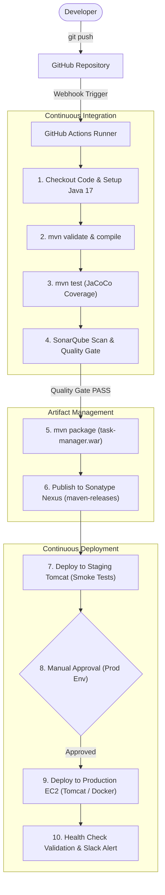

# Real-Time DevOps Interview Guide: GitHub Actions, Jenkins, SonarQube, Nexus & CI/CD Pipelines

A practical, real-world interview preparation reference for DevOps engineers with around 3 years of experience. This guide covers technical concepts, architecture, end-to-end pipeline implementation, hands-on debugging, scenario-based questions, and production incident resolution.

---

## Table of Contents

1. [GitHub Actions](#1-github-actions)
   - [Core Concepts & Basic Technical Questions](#11-core-concepts--basic-technical-questions)
   - [Advanced Technical & Architecture Questions](#12-advanced-technical--architecture-questions)
   - [Real-Time Project Implementation & Deployment](#13-real-time-project-implementation--deployment)
   - [Troubleshooting & Scenario-Based Questions](#14-troubleshooting--scenario-based-questions)
2. [SonarQube](#2-sonarqube)
   - [Core Concepts & Working Architecture](#21-core-concepts--working-architecture)
   - [Quality Gates, Profiles & Code Metrics](#22-quality-gates-profiles--code-metrics)
   - [CI/CD Integration (GitHub Actions & Jenkins)](#23-cicd-integration-github-actions--jenkins)
   - [Troubleshooting & Production Scenarios](#24-troubleshooting--production-scenarios)
3. [Sonatype Nexus Repository](#3-sonatype-nexus-repository)
   - [Core Concepts & Architecture](#31-core-concepts--architecture)
   - [Hosted, Proxy, and Group Repositories](#32-hosted-proxy-and-group-repositories)
   - [Artifact Management, Versioning & CI/CD Integration](#33-artifact-management-versioning--cicd-integration)
   - [Authentication, Connectivity & Troubleshooting](#34-authentication-connectivity--troubleshooting)
4. [Jenkins CI/CD](#4-jenkins-cicd)
   - [Architecture & Master-Agent Configuration](#41-architecture--master-agent-configuration)
   - [Declarative vs. Scripted Pipelines](#42-declarative-vs-scripted-pipelines)
   - [End-to-End Pipeline & Real-Time Scenarios](#43-end-to-end-pipeline--real-time-scenarios)
5. [End-to-End CI/CD & DevOps Engineering](#5-end-to-end-cicd--devops-engineering)
   - [Source Code Management & Git Branching](#51-source-code-management--git-branching)
   - [Complete Pipeline Workflow (Git to AWS EC2)](#52-complete-pipeline-workflow-git-to-aws-ec2)
   - [Tomcat & AWS EC2 Deployment Details](#53-tomcat--aws-ec2-deployment-details)
   - [Docker Integration & Container Management](#54-docker-integration--container-management)
   - [Multi-Environment Strategy, Security & Rollbacks](#55-multi-environment-strategy-security--rollbacks)

---

## 1. GitHub Actions

### 1.1 Core Concepts & Basic Technical Questions

#### Q1: What is GitHub Actions, and how is it structured in a project?
**Answer:**  
In our project, GitHub Actions is our primary continuous integration and continuous delivery (CI/CD) platform natively built into GitHub. It allows us to automate builds, automated tests, code quality scans, artifact packaging, and deployments directly from repository events.

The architecture consists of five core components:
1. **Workflows:** An automated configurable process made of one or more jobs defined in a YAML file located inside the `.github/workflows/` directory of the repository.
2. **Events (Triggers):** Specific activities that trigger a workflow run, such as `push`, `pull_request`, `release`, `schedule` (cron), or manual triggers like `workflow_dispatch`.
3. **Jobs:** A set of steps executed sequentially on the same runner instance. Jobs run in parallel by default unless ordered using the `needs` keyword.
4. **Steps:** Individual tasks inside a job that either run shell commands (`run:`) or execute reusable packaged actions (`uses:`).
5. **Runners:** Virtual machines or containers that listen for available jobs, run the steps, and report progress back to GitHub.

---

#### Q2: Your team created a GitHub Actions workflow. You didn't configure any servers, but the workflow still ran successfully. Where did the workflow run?
**Answer:**  
GitHub Actions uses **GitHub-hosted runners** by default.

For example, if I configure `runs-on: ubuntu-latest` in my workflow, GitHub automatically provisions a temporary, clean Ubuntu virtual machine (hosted on Microsoft Azure infrastructure) to execute the pipeline. I don't need to create an EC2 instance, provision storage, or configure my own server for this.

The hosted runner checks out the source code, installs the required toolchains (like Java, Maven, Python, Docker), executes build commands, runs unit tests, and generates the application artifact.

```yaml
jobs:
  build:
    runs-on: ubuntu-latest
    steps:
      - name: Checkout source code
        uses: actions/checkout@v4

      - name: Build application
        run: mvn clean package
```

After the job finishes, the hosted runner environment and its disk are completely destroyed and discarded.

---

#### Q3: What is the main difference between a GitHub-hosted runner and a self-hosted runner?
**Answer:**  
The main difference is **infrastructure management, environment control, and network security**:

| Feature | GitHub-Hosted Runner | Self-Hosted Runner |
| :--- | :--- | :--- |
| **Maintenance** | Fully managed, updated, and patched by GitHub. | Managed, secured, and updated by our DevOps team. |
| **Hosting Environment** | Runs on GitHub/Azure cloud infrastructure. | Runs on our own AWS EC2 instance, on-prem server, or Kubernetes cluster. |
| **State** | Ephemeral: a clean VM is created per job and destroyed after completion. | Persistent by default (unless configured as ephemeral using container hooks). |
| **Network Access** | Public internet only; cannot access private subnets without VPN/NAT gateways. | Can sit directly inside our AWS Private VPC to access internal databases, Nexus, SonarQube, and EC2 instances. |
| **Custom Hardware/Software** | Standard compute options (2-core / 4-core, etc.). | Any size (high CPU, GPU, customized kernel, pre-cached Docker images). |
| **Cost** | Consumes included GitHub plan minutes or per-minute billing. | Free GitHub software runner; we only pay for our underlying AWS EC2/server cost. |

**In my project:**  
I prefer **GitHub-hosted runners** for standard builds, static linting, and public deployments because they require zero server maintenance. However, when we need to access private internal resources (such as an internal Nexus repository, on-prem SonarQube, or private EC2 instances behind a corporate firewall), I configure a secured **self-hosted runner** inside our AWS private VPC.

---

#### Q4: How do environment variables (`env`), repository variables (`vars`), and secrets (`secrets`) differ in GitHub Actions?
**Answer:**  
In our CI/CD pipelines, we handle configuration and sensitive data through three distinct mechanisms:

1. **Secrets (`${{ secrets.SECRET_NAME }}`):**
   - Encrypted credentials such as API keys, SonarQube tokens, Tomcat passwords, and SSH private keys.
   - Once saved in repository or organization settings, their values can never be viewed in plain text.
   - GitHub automatically masks secret values in console execution logs to prevent leakage.
2. **Repository Variables (`${{ vars.VARIABLE_NAME }}`):**
   - Non-sensitive configuration data that varies across repositories or environments (e.g., `PORT: 8080`, `ENVIRONMENT_NAME: dev`, `TOMCAT_HOST_URL`).
   - Visible in plain text in repository settings and logs, making them easy to audit.
3. **Workflow Environment Variables (`env:` block):**
   - Defined directly inside the YAML file at the workflow level, job level, or step level.
   - Accessible within steps as environment variables (e.g., `$WAR_FILE` in bash or `$env:WAR_FILE` in PowerShell).

```yaml
env:
  APPLICATION_NAME: task-manager

jobs:
  deploy:
    runs-on: ubuntu-latest
    steps:
      - name: Deploy application
        env:
          APP_PORT: ${{ vars.APP_PORT }}
          AUTH_TOKEN: ${{ secrets.DEPLOYMENT_TOKEN }}
        run: |
          echo "Deploying $APPLICATION_NAME on port $APP_PORT"
          ./deploy.sh --token "$AUTH_TOKEN"
```

---

#### Q5: How do you pass data or share artifacts between different jobs in GitHub Actions?
**Answer:**  
Because each job runs on an isolated virtual machine or container, memory and filesystem state are not shared between jobs. What I do in our pipelines depends on the type of data:

1. **For files and build binaries (e.g., `.war`, `.jar`, `.tar.gz`):**
   I use the official `actions/upload-artifact@v4` in the build job and `actions/download-artifact@v4` in the downstream deployment job.

   ```yaml
   jobs:
     build:
       runs-on: ubuntu-latest
       steps:
         - uses: actions/checkout@v4
         - run: mvn clean package
         - uses: actions/upload-artifact@v4
           with:
             name: application-war
             path: target/task-manager.war
             retention-days: 5

     deploy:
       needs: build
       runs-on: ubuntu-latest
       steps:
         - uses: actions/download-artifact@v4
           with:
             name: application-war
             path: target/
         - run: ls -lh target/task-manager.war
   ```

2. **For small string outputs (e.g., dynamic version tags, commit SHAs):**
   I write to `$GITHUB_OUTPUT` and declare job-level outputs:

   ```yaml
   jobs:
     setup:
       runs-on: ubuntu-latest
       outputs:
         version_tag: ${{ steps.get_version.outputs.app_version }}
       steps:
         - id: get_version
           run: echo "app_version=v$(date +'%Y%m%d%H%M')" >> "$GITHUB_OUTPUT"

     release:
       needs: setup
       runs-on: ubuntu-latest
       steps:
         - run: echo "Deploying version ${{ needs.setup.outputs.version_tag }}"
   ```

---

### 1.2 Advanced Technical & Architecture Questions

#### Q6: Your GitHub Actions workflow is triggered every time code is pushed to any branch, but you want it to run only for the `main` branch. How can you achieve this?
**Answer:**  
I control this using branch filters in the `on.push` trigger configuration in the GitHub Actions workflow YAML file.

For example:
```yaml
name: Java CI/CD

on:
  push:
    branches:
      - main
  workflow_dispatch:
```

With this configuration, the workflow will execute automatically only when code is pushed or merged into the `main` branch.

If I also want to allow team members to trigger the workflow manually for emergency deployments or testing, I include `workflow_dispatch:`.

**In a real-time project:**  
Developers frequently push commits to feature branches (e.g., `feature/login`, `bugfix/auth-leak`). We do not want every feature branch commit to trigger an expensive multi-stage production deployment. For feature branches, we maintain a separate lightweight pull-request workflow (`on: pull_request: branches: [ main ]`) that only runs unit tests and static code analysis, ensuring only the approved and tested `main` branch triggers full deployments.

---

#### Q7: Your company wants the GitHub Actions workflow to run on its own EC2 server because it has custom software installed. Which runner should you use?
**Answer:**  
In this scenario, I would use a **self-hosted GitHub Actions runner**.

A self-hosted runner allows us to configure our own AWS EC2 instance and pre-install all required software, such as Oracle JDK, Maven, Docker, AWS CLI, internal VPN certificates, and proprietary deployment scripts.

Here is the exact step-by-step implementation I follow:
1. Go to the GitHub repository (or organization) **Settings** -> **Actions** -> **Runners** -> click **New self-hosted runner**.
2. Select the OS (`Linux`) and Architecture (`x64`).
3. SSH into the target EC2 instance and run the setup commands provided by GitHub:
   ```bash
   # Create a folder and download the runner package
   mkdir -p actions-runner && cd actions-runner
   curl -o actions-runner-linux-x64-2.319.1.tar.gz -L https://github.com/actions/runner/releases/download/v2.319.1/actions-runner-linux-x64-2.319.1.tar.gz
   tar xzf ./actions-runner-linux-x64-2.319.1.tar.gz

   # Configure the runner with repository token
   ./config.sh --url https://github.com/my-org/JavaApplication --token AXXXXXXXXXXXXXX --name ec2-build-agent --labels ec2-java,production

   # Install and start as a background systemd service
   sudo ./svc.sh install
   sudo ./svc.sh start
   ```
4. Update the workflow YAML file to target this runner:
   ```yaml
   jobs:
     build:
       runs-on: [self-hosted, ec2-java]
       steps:
         - uses: actions/checkout@v4
         - name: Build application
           run: mvn clean package
   ```

Now the workflow executes directly on our private EC2 server, providing instant access to internal corporate networks and avoiding the overhead of re-downloading large dependencies on every run.

---

#### Q8: How do GitHub Environments, Protection Rules, and Manual Approvals work for multi-environment pipelines?
**Answer:**  
In enterprise production deployments, you must prevent unreviewed code from hitting production. GitHub Actions solves this through **Environments**.

In my project, we set up four environments in GitHub Settings -> Environments:
- `Development`
- `Testing / QA`
- `Staging / Pre-Production`
- `Production`

For the `Production` environment, we configure **Environment Protection Rules**:
1. **Required Reviewers:** We specify lead engineers or DevOps managers who must click "Review Deployments" and approve before the job begins.
2. **Wait Timer:** A delay (e.g., 5 minutes) before running to give engineers time to verify pre-checks.
3. **Deployment Branches:** Only allow runs coming from `refs/heads/main` or tags matching `v*.*.*`.
4. **Environment-Specific Secrets:** Production database URLs and production API keys are stored only inside the `Production` environment, meaning standard test jobs cannot access production credentials.

In the workflow YAML:
```yaml
jobs:
  deploy_staging:
    runs-on: ubuntu-latest
    environment:
      name: Staging
      url: https://staging.example.com
    steps:
      - run: ./deploy.sh staging

  deploy_production:
    needs: deploy_staging
    runs-on: ubuntu-latest
    environment:
      name: Production
      url: https://app.example.com
    steps:
      - run: ./deploy.sh production
```
When `deploy_staging` completes, GitHub pauses the workflow and sends an email/notification to designated approvers. The production job executes only after explicit approval is granted.

---

#### Q9: What is the difference between Reusable Workflows (`workflow_call`) and Composite Actions?
**Answer:**  
Both reduce code duplication across teams, but they operate at different hierarchy levels:

- **Composite Actions:**
  - Packages a sequence of **steps** into a single custom action.
  - Defined in an `action.yml` file.
  - Runs inside the context of an existing job runner.
  - Best used when you have repetitive steps (e.g., installing a specific CLI tool, authenticating to a cloud provider, setting up custom cache).

- **Reusable Workflows:**
  - Shares entire **workflows** (including multiple jobs, runner specifications, matrices, secrets, and environment rules).
  - Defined in `.github/workflows/shared-pipeline.yml` with the trigger `on: workflow_call`.
  - Replaces 100+ lines of duplicate pipeline code across dozens of microservice repositories.
  - Best used when an organization enforces standard CI/CD lifecycle stages across all repositories (e.g., standard build -> SonarQube -> Docker build -> deploy).

---

#### Q10: How do you prevent multiple redundant pipeline runs when developers push frequent commits to the same branch?
**Answer:**  
I use the `concurrency` configuration with `cancel-in-progress: true`.

```yaml
concurrency:
  group: ${{ github.workflow }}-${{ github.ref }}
  cancel-in-progress: true
```

If a developer pushes commit `A` and immediately pushes commit `B` 30 seconds later, GitHub automatically terminates the running job for commit `A` and starts the job for commit `B`. This prevents resource waste and avoids race conditions where an older commit finishes after a newer commit and deploys outdated code.

---

### 1.3 Real-Time Project Implementation & Deployment

#### Q11: How do you deploy a Java WAR application to an EC2 instance using SSH in GitHub Actions?
**Answer:**  
In our project, when deploying without the Tomcat Manager API, we deploy directly to target EC2 instances using SSH and `rsync` or `scp`.

Here is the secure method we implement in our GitHub Actions workflow:
1. Store the EC2 SSH Private Key, EC2 Public IP, and EC2 SSH User inside **GitHub Secrets** (`EC2_SSH_KEY`, `EC2_HOST`, `EC2_USER`).
2. Use the standard Linux SSH agent in the runner:

```yaml
- name: Deploy application to EC2 via SSH
  env:
    SSH_PRIVATE_KEY: ${{ secrets.EC2_SSH_KEY }}
    HOST: ${{ secrets.EC2_HOST }}
    USER: ${{ secrets.EC2_USER }}
  run: |
    # Setup private key securely in runner memory
    mkdir -p ~/.ssh
    echo "$SSH_PRIVATE_KEY" > ~/.ssh/deploy_key
    chmod 600 ~/.ssh/deploy_key

    # Add EC2 host to known_hosts to prevent interactive authenticity prompts
    ssh-keyscan -H "$HOST" >> ~/.ssh/known_hosts

    # 1. Copy the new WAR file to a temporary location on EC2
    scp -i ~/.ssh/deploy_key target/task-manager.war "$USER@$HOST":/tmp/task-manager.war

    # 2. Execute zero-downtime deployment script on the EC2 instance
    ssh -i ~/.ssh/deploy_key "$USER@$HOST" << 'EOF'
      set -e
      echo "Backing up current deployment..."
      sudo cp /opt/tomcat/webapps/task-manager.war /opt/tomcat/backups/task-manager.war.bak || true

      echo "Deploying new artifact..."
      sudo systemctl stop tomcat
      sudo rm -rf /opt/tomcat/webapps/task-manager
      sudo mv /tmp/task-manager.war /opt/tomcat/webapps/task-manager.war
      sudo systemctl start tomcat

      echo "Validating health check..."
      sleep 10
      curl --fail http://localhost:8080/task-manager/ || {
        echo "Health check failed! Rolling back..."
        sudo mv /opt/tomcat/backups/task-manager.war.bak /opt/tomcat/webapps/task-manager.war
        sudo systemctl restart tomcat
        exit 1
      }
      echo "Deployment succeeded!"
    EOF
```

This guarantees that if the health check fails, the previous working artifact is immediately restored.

---

#### Q12: How do you deploy to multiple EC2 target servers simultaneously?
**Answer:**  
I achieve this in GitHub Actions using one of two methods:

1. **Matrix Strategy (Built-in to GitHub Actions):**
   ```yaml
   jobs:
     deploy:
       runs-on: ubuntu-latest
       strategy:
         matrix:
           target_server:
             - 10.0.1.15
             - 10.0.1.16
             - 10.0.1.17
       steps:
         - name: Deploy to ${{ matrix.target_server }}
           run: ./deploy-to-node.sh --host ${{ matrix.target_server }}
   ```
2. **Ansible Playbook Execution from Runner:**
   In enterprise environments with 10+ instances behind an Application Load Balancer (ALB), running individual SSH commands inside a matrix gets messy. What I do is install Ansible on the runner, feed it a dynamic inventory of target EC2 instances, and execute an Ansible playbook with a `serial: 1` rolling update strategy so servers are updated one at a time without user-facing downtime.

---

### 1.4 Troubleshooting & Scenario-Based Questions

#### Q13: A developer pushes new code to GitHub, but the GitHub Actions workflow does not start automatically. What will you check?
**Answer:**  
First, I will check whether the workflow YAML file is available inside the `.github/workflows/` directory. Then I'll verify the trigger configuration and check whether the developer pushed code to the correct branch.

I'll also check whether GitHub Actions is enabled in the repository, whether the YAML syntax is correct, and whether any branch or path filters are preventing the workflow from executing.

For example, if my workflow is configured to trigger only on the `main` branch but the developer pushes code to the `develop` branch, the workflow will not start.

I'll also check:
1. **GitHub Actions Repository Permissions:** Navigate to **Settings** -> **Actions** -> **General** to verify that "Allow all actions and reusable workflows" is selected and Actions are not disabled.
2. **YAML Syntax Errors:** Check the repository's **Actions** tab. If a syntax error exists, GitHub displays a red banner saying "Invalid workflow file".
3. **Path Filters:** Check if the workflow uses `paths:` or `paths-ignore:`. If a workflow is configured with `paths: ['src/**']` and the developer only modified `README.md` or `docs/`, the workflow is intentionally skipped.
4. **Branch Protection / Fork Restrictions:** If the commit was pushed from a fork or a pull request with merge conflicts, checks may be blocked.

I'll correct the branch configuration or push to the appropriate branch and verify the execution in the GitHub Actions tab.

---

#### Q14: Your GitHub Actions workflow fails during the Maven build stage. How will you troubleshoot?
**Answer:**  
First, I'll check the GitHub Actions execution logs to identify the exact error.

Then I'll verify the Java and Maven versions and check whether all required dependencies are available.

I'll execute the Maven commands step by step:
```bash
mvn validate
mvn compile
mvn test
mvn clean package
```

If the issue is related to Java compatibility, I'll configure the correct Java version in the GitHub Actions workflow. For example, if the application code uses Java 17 features (like records or switch expressions) but the runner is initialized with Java 11, compilation will fail with `source option 17 is no longer supported` or `unrecognized class file version`. I update `actions/setup-java@v4`:
```yaml
- uses: actions/setup-java@v4
  with:
    distribution: 'corretto'
    java-version: '17'
    cache: 'maven'
```

If it's a dependency issue (e.g., `Could not resolve dependencies` or `500 Server Error` from Maven Central), I'll check the `pom.xml` file and Maven repository connectivity.

If unit tests are failing (`mvn test`), I will look at the Surefire reports in the logs to pinpoint the exact assertion or null pointer failure.

After fixing the issue, I'll rerun the pipeline and verify that the build completes successfully and generates the required WAR file.

---

#### Q15: The Maven build is successful, but no WAR file is generated. What could be the reason?
**Answer:**  
First, I'll check the packaging configuration in the `pom.xml` file.

For a Java web application that needs to run on Tomcat, the packaging type must be explicitly set to `war`. If omitted, Maven defaults to `jar`.
```xml
<groupId>com.company.app</groupId>
<artifactId>task-manager</artifactId>
<version>1.0.0</version>
<packaging>war</packaging>
```

Then I'll execute:
```bash
mvn clean package
```

After the build, I'll check the `target` directory:
```bash
ls -lh target/
```

I'll also verify whether the generated WAR filename matches the filename configured in my GitHub Actions workflow.

For example, by default, Maven appends the version number to the artifact: `task-manager-1.0.0.war`. However, our GitHub Actions deployment script might expect a static name like `task-manager.war`.

To prevent version mismatch issues, I ensure the `<build>` section of `pom.xml` has a fixed `<finalName>`:
```xml
<build>
  <finalName>task-manager</finalName>
</build>
```
If the filenames don't match, I'll correct the Maven `finalName` configuration or update the workflow artifact pattern accordingly.

---

#### Q16: Your workflow fails because the secret `AWS_ACCESS_KEY_ID` cannot be found. How will you fix it?
**Answer:**  
First, I'll check whether the AWS access key is correctly configured inside GitHub Secrets.

I'll navigate to **Repository Settings** -> **Secrets and variables** -> **Actions**.

I'll verify whether the secret name matches the reference in my workflow. For example:
```yaml
- name: Configure AWS credentials
  uses: aws-actions/configure-aws-credentials@v4
  with:
    aws-access-key-id: ${{ secrets.AWS_ACCESS_KEY_ID }}
    aws-secret-access-key: ${{ secrets.AWS_SECRET_ACCESS_KEY }}
    aws-region: ap-south-2
```

I'll also check:
1. Whether the secret was configured at the **Environment** level rather than the **Repository** level. If a secret is tied to an environment named `Production`, the workflow job must declare `environment: Production` to access it.
2. Typos in secret naming (e.g., `AWS_ACCESS_KEY` instead of `AWS_ACCESS_KEY_ID`).
3. Whether the run was triggered from a forked repository PR (by default, GitHub does not pass secrets to pull requests from forks for security reasons).

**Best Practice for Production:**  
For production deployments, I prefer **AWS OIDC (OpenID Connect) authentication** instead of storing long-lived, permanent access keys in GitHub Secrets.

With OIDC, GitHub Actions requests a short-lived token and assumes an AWS IAM role directly:
```yaml
permissions:
  id-token: write
  contents: read

steps:
  - name: Configure AWS credentials via OIDC
    uses: aws-actions/configure-aws-credentials@v4
    with:
      role-to-assume: arn:aws:iam::123456789012:role/GitHubActionsDeploymentRole
      aws-region: ap-south-2
```
This eliminates the risk of credential leakage and eliminates secret rotation overhead.

---

#### Q17: A self-hosted runner fails with "No space left on device" during a Docker or Maven build. How do you resolve this?
**Answer:**  
- **Problem:** Persistent self-hosted runners do not destroy their disk after every run. Over time, unused Docker images, dangling layers, and large Maven `~/.m2/repository` directories consume all available EBS disk space on the EC2 instance.
- **Investigation:**
  1. SSH into the runner EC2 instance.
  2. Check disk usage using `df -h` and `docker system df`.
- **Troubleshooting & Fix:**
  1. Run automated cleanup on Docker objects:
     ```bash
     docker system prune -af --volumes
     ```
  2. Clean up old Maven caches or prune files older than 30 days:
     ```bash
     find ~/.m2/repository -type f -atime +30 -delete
     ```
  3. Set up a automated cron job on the runner instance to keep disk usage healthy:
     ```bash
     0 3 * * * docker system prune -af --volumes
     ```
  4. In the workflow itself, add a cleanup step at the end of the job:
     ```yaml
     - name: Clean workspace
       if: always()
       run: rm -rf "${{ github.workspace }}/*"
     ```
- **Outcome:** The runner maintains 40%+ free disk capacity and subsequent builds execute without disk allocation failures.

---

## 2. SonarQube

### 2.1 Core Concepts & Working Architecture

#### Q18: What is SonarQube, and what is its high-level architecture?
**Answer:**  
In our DevOps toolchain, **SonarQube** is our centralized static application security testing (SAST) and code quality inspection platform. It scans source code without running it to find security vulnerabilities, bugs, and technical debt before code is merged.

```
+-------------------------------------------------------------+
|                     1. SonarScanner                         |
|  (CLI / Maven / Gradle running on Dev Machine or CI Runner) |
+------------------------------+------------------------------+
                               |
                   HTTP/REST   | Uploads Analysis Report (.zip)
                               v
+-------------------------------------------------------------+
|                   2. SonarQube Server                       |
|                                                             |
|  +---------------------------+  +------------------------+  |
|  |     Web Server            |  |   Compute Engine (CE)  |  |
|  |  (UI, REST API, Auth)     |  |  (Processes Reports,   |  |
|  +---------------------------+  |   Calculates Metrics)  |  |
|                                 +-----------+------------+  |
|  +---------------------------+              |               |
|  |   Search Server (ES)      |              | Reads/Writes  |
|  +---------------------------+              v               |
+---------------------------------------------|---------------+
                                              v
+-------------------------------------------------------------+
|                      3. Database                            |
|                 (PostgreSQL / Oracle / MSSQL)               |
+-------------------------------------------------------------+
```

Its architecture consists of four main components:
1. **SonarScanner:** The client agent (e.g., `sonar-maven-plugin` or SonarScanner CLI) running in the GitHub Actions runner or developer machine. It parses the source code, reads unit test and code coverage reports, builds an analysis bundle, and transmits it to the SonarQube server over HTTP/HTTPS.
2. **Web Server:** Powers the user interface, manages user authentication, permission schemes, project settings, and serves REST API endpoints.
3. **Compute Engine (CE):** A multi-threaded backend worker process. It pulls raw analysis reports submitted by scanners from an internal processing queue, analyzes the AST (Abstract Syntax Tree), evaluates rules and Quality Gates, computes metrics, and writes the results to the database.
4. **Search Server (Elasticsearch):** Indexes issues, rules, projects, and components to provide instantaneous search performance across millions of lines of code.
5. **Database:** Stores historical metrics, project configurations, issues, and user permissions. In production, we run PostgreSQL.

---

#### Q19: What is the difference between a Quality Profile and a Quality Gate?
**Answer:**  
Interviewers often ask this to test whether a candidate understands how SonarQube applies rules versus how it enforces release criteria:

- **Quality Profile:**
  - Defines the **rules** that are active for a specific programming language during the scan.
  - For example, in Java, our Quality Profile has 450 active rules, including "SQL queries should not be concatenated with user input (Vulnerability)" and "Null checks must precede method calls (Bug)".
  - Think of the Quality Profile as the **inspection criteria** (what rules are checked).

- **Quality Gate:**
  - Defines the **pass/fail criteria (thresholds)** that determine whether an artifact is production-ready.
  - Think of the Quality Gate as the **decision maker** (is the code good enough to deploy?).
  - For example, our Quality Gate enforces:
    - 0 New Bugs
    - 0 New Vulnerabilities (Security Rating = A)
    - Code Coverage on New Code >= 80%
    - Duplicated Lines on New Code < 3%
  - If any condition fails, the Quality Gate status turns **RED (FAILED)**, and our CI/CD pipeline immediately stops deployment.

---

#### Q20: Explain the difference between Bugs, Vulnerabilities, Security Hotspots, and Code Smells.
**Answer:**  
In SonarQube, issues are categorized into four distinct types:

1. **Bugs:** Coding mistakes that are demonstrably wrong and will cause runtime crashes or unexpected behavior.
   - *Example:* Calling `.equals()` on an object that could be `null` (`NullPointerException`), infinite loops, or unclosed file streams.
2. **Vulnerabilities:** Flaws in code that can be directly exploited by attackers to compromise system security.
   - *Example:* SQL Injection (`"SELECT * FROM users WHERE id = " + input`), Cross-Site Scripting (XSS), or hardcoded API tokens.
3. **Security Hotspots:** Security-sensitive code that is not necessarily buggy or vulnerable, but requires manual human review to confirm whether it is safe in context.
   - *Example:* Using MD5 for hashing, disabling CSRF tokens in Spring Security, or binding a service to `0.0.0.0`.
4. **Code Smells:** Maintainability issues that do not break functionality, but make code confusing, messy, brittle, and difficult to maintain.
   - *Example:* Duplicate code blocks, methods with more than 80 lines, unused imports, or high cyclomatic complexity.

---

### 2.2 Quality Gates, Profiles & Code Metrics

#### Q21: What is Code Coverage, and how does SonarQube capture it in a Java Maven project?
**Answer:**  
Code coverage measures the percentage of your source code executed during automated test runs. High coverage ensures that business logic is validated by unit tests.

SonarQube **does not execute unit tests itself**. Instead, it relies on a test coverage tool like **JaCoCo (Java Code Coverage)**.

In my project, we configure the `jacoco-maven-plugin` in `pom.xml`:
```xml
<plugin>
  <groupId>org.jacoco</groupId>
  <artifactId>jacoco-maven-plugin</artifactId>
  <version>0.8.11</version>
  <executions>
    <execution>
      <goals>
        <goal>prepare-agent</goal>
      </goals>
    </execution>
    <execution>
      <id>report</id>
      <phase>test</phase>
      <goals>
        <goal>report</goal>
      </goals>
    </execution>
  </executions>
</plugin>
```

When our pipeline runs:
1. `mvn test` executes the unit tests, and the JaCoCo agent generates an execution report at `target/site/jacoco/jacoco.xml`.
2. When the SonarScanner plugin runs, it reads `target/site/jacoco/jacoco.xml` and uploads the coverage metrics to SonarQube:
   ```bash
   mvn sonar:sonar -Dsonar.coverage.jacoco.xmlReportPaths=target/site/jacoco/jacoco.xml
   ```
3. SonarQube evaluates the coverage against our Quality Gate condition (e.g., `>= 80% on New Code`).

---

#### Q22: What is the "Clean as You Code" methodology in SonarQube?
**Answer:**  
In legacy applications with 10 years of existing code, fixing 5,000 old code smells and legacy bugs all at once is impossible.

SonarQube's **Clean as You Code** approach focuses Quality Gate conditions **strictly on New Code (code written or modified in the current branch, pull request, or release window)**.
- It ensures developers do not introduce new technical debt.
- New code must have 0 bugs, 0 vulnerabilities, and >= 80% coverage.
- Over time, as legacy modules are touched and refactored, the overall codebase quality steadily improves without paralyzing engineering velocity.

---

### 2.3 CI/CD Integration (GitHub Actions & Jenkins)

#### Q23: How do you integrate SonarQube into a GitHub Actions workflow?
**Answer:**  
In our repository workflow (`deploy.yaml`), we integrate SonarQube using the `sonar-maven-plugin`.

Here is the exact production configuration:
```yaml
- name: Build and analyze with SonarQube
  env:
    SONAR_TOKEN: ${{ secrets.SONAR_TOKEN }}
    SONAR_HOST_URL: ${{ secrets.SONAR_HOST }}
  run: |
    mvn --batch-mode \
      org.sonarsource.scanner.maven:sonar-maven-plugin:sonar \
      verify \
      -Dsonar.projectKey=task-manager \
      -Dsonar.host.url=$SONAR_HOST_URL \
      -Dsonar.login=$SONAR_TOKEN \
      -Dsonar.qualitygate.wait=true \
      -Dsonar.qualitygate.timeout=300
```

**Key Parameters Explained:**
- `-Dsonar.projectKey`: Unique identifier for the project in SonarQube.
- `-Dsonar.qualitygate.wait=true`: Makes the Maven step **block and wait** until SonarQube's Compute Engine processes the report and returns the Quality Gate status (PASSED or FAILED). If FAILED, the Maven step exits with code 1, immediately halting the pipeline.
- `-Dsonar.qualitygate.timeout=300`: Maximum time (5 minutes) to wait for Compute Engine processing before timing out.

---

#### Q24: How does SonarQube integrate with Jenkins?
**Answer:**  
In Jenkins, we install the **SonarQube Scanner for Jenkins** plugin and configure the server under **Manage Jenkins** -> **System**.

In our declarative `Jenkinsfile`, we use the `withSonarQubeEnv` wrapper and the `waitForQualityGate()` step:
```groovy
stage('SonarQube Analysis') {
    steps {
        withSonarQubeEnv('My-SonarQube-Server') {
            sh 'mvn org.sonarsource.scanner.maven:sonar-maven-plugin:sonar -Dsonar.projectKey=task-manager'
        }
    }
}

stage('Quality Gate') {
    steps {
        timeout(time: 5, unit: 'MINUTES') {
            script {
                def qg = waitForQualityGate()
                if (qg.status != 'OK') {
                    error "Pipeline aborted: SonarQube Quality Gate failed with status: ${qg.status}"
                }
            }
        }
    }
}
```
In Jenkins, `waitForQualityGate()` relies on **SonarQube Webhooks**: when Compute Engine finishes processing, SonarQube sends an HTTP POST callback to `http://JENKINS_URL/sonarqube-webhook/`, waking up the Jenkins pipeline step instantly without polling.

---

### 2.4 Troubleshooting & Production Scenarios

#### Q25: Your SonarQube stage fails with an "Authentication Failed" error. What will you check?
**Answer:**  
First, I'll check whether the SonarQube authentication token is correctly configured in GitHub Secrets.

I'll verify whether the token is valid, whether it has expired, and whether the secret name matches the reference in the workflow YAML file.

I'll also check the SonarQube server URL and whether the GitHub Actions runner can communicate with the SonarQube server.

For example, I configure the token like this:
```yaml
- name: SonarQube Analysis
  env:
    SONAR_TOKEN: ${{ secrets.SONAR_TOKEN }}
    SONAR_HOST: ${{ secrets.SONAR_HOST }}
  run: |
    mvn sonar:sonar \
      -Dsonar.host.url=$SONAR_HOST \
      -Dsonar.token=$SONAR_TOKEN
```

I never hardcode credentials inside the workflow file.

**Additional Troubleshooting Steps I Follow:**
1. **Token Permissions in SonarQube:** Log into SonarQube as an admin, go to **My Account** -> **Security**, and check if the token has the "Execute Analysis" permission for the `task-manager` project.
2. **Secret Scope:** Verify whether `SONAR_TOKEN` was added as a Repository Secret or an Environment Secret.
3. **Network Reachability:** If SonarQube is hosted on an internal EC2 instance inside a private subnet and the workflow runs on a public GitHub-hosted runner, the runner cannot route to the private IP/domain. I run:
   ```bash
   curl -I -k "$SONAR_HOST/api/system/status"
   ```
   If it times out, the issue is AWS Security Group ingress rules or missing runner routing.

After correcting the token or configuration, I'll rerun the pipeline and verify the SonarQube analysis result.

---

#### Q26: The pipeline fails because the Quality Gate status is RED. As a DevOps engineer, what is your troubleshooting process?
**Answer:**  
- **Scenario:** A pull request build fails during the `SonarQube Quality Gate` check.
- **Investigation:**
  1. Open the GitHub Actions execution log. Locate the direct analysis URL printed by the scanner:
     ```
     ANALYSIS SUCCESSFUL, you can find the results at: https://sonar.example.com/dashboard?id=task-manager
     ```
  2. Click the dashboard link and view the **Quality Gate breakdown** on the project page.
  3. Identify which specific metric breached the threshold (e.g., `Coverage on New Code: 68.2% < 80.0%` or `1 Blocker Bug detected`).
- **Resolution:**
  1. If it's a legitimate bug or low coverage: Notify the developer with the exact SonarQube issue link so they can add the required unit tests or fix the offending code in their branch.
  2. If it's a false positive (e.g., a rule flagging a secure utility method as a false vulnerability): The tech lead or security engineer can mark the issue as **"False Positive"** or **"Won't Fix"** in the SonarQube UI with a documented comment. Marking it updates the Quality Gate to green, allowing the PR to be merged.
- **Outcome:** Production release standards are maintained without bypassing quality controls.

---

## 3. Sonatype Nexus Repository

### 3.1 Core Concepts & Architecture

#### Q27: What is Sonatype Nexus Repository Manager, and why is an artifact repository essential in DevOps?
**Answer:**  
In our CI/CD pipeline, **Nexus Repository Manager** acts as the single source of truth for all software packages, binaries, dependencies, and deployment artifacts.

Without an artifact repository:
- Builds would directly deploy unversioned files directly from developer machines, making rollback impossible.
- Every build would download thousands of libraries directly from the public internet (Maven Central, Docker Hub), leading to slow builds, bandwidth waste, and susceptibility to outages or supply-chain attacks.

Nexus solves this by providing:
1. **Centralized artifact versioning:** Stores immutable release WAR/JAR binaries tagged with semantic versions (`task-manager-1.0.0.war`).
2. **Dependency caching & isolation:** Caches open-source dependencies inside our private network.
3. **Auditability & Compliance:** Every binary deployed to production can be traced back to the exact commit SHA and build job that created it.

---

#### Q28: What is the architectural difference between Hosted, Proxy, and Group repositories in Nexus?
**Answer:**  
This is one of the most common Nexus interview questions. Here is how I explain it with real-world examples:

```
                      +---------------------------------------+
                      |           Nexus Group Repo            |
                      |          (maven-all-public)           |
                      +-------------------+-------------------+
                                          |
                   +----------------------+----------------------+
                   |                                             |
                   v                                             v
+-------------------------------------+       +-------------------------------------+
|        Hosted Repository            |       |          Proxy Repository           |
|         (maven-releases)            |       |           (maven-central)           |
|                                     |       |                                     |
|  Stores our internal binaries:      |       |  Proxies & caches external public   |
|  - task-manager-1.0.0.war           |       |  dependencies from Maven Central    |
+-------------------------------------+       +------------------+------------------+
                                                                 | HTTP
                                                                 v
                                              +-------------------------------------+
                                              |       Public Internet               |
                                              |      (repo1.maven.org)              |
                                              +-------------------------------------+
```

1. **Hosted Repository:**
   - Stores our **internal, proprietary artifacts** generated by our own CI/CD builds.
   - Nobody outside our organization has access to it.
   - Examples: `maven-releases` (for final production builds), `maven-snapshots` (for active dev builds), and `docker-private`.
2. **Proxy Repository:**
   - Acts as a local cache for a remote **public external repository**.
   - When a developer or pipeline requests `org.springframework:spring-core:6.0.0`:
     - If it's already in the Nexus proxy cache, Nexus serves it instantly at LAN speeds.
     - If not, Nexus downloads it from Maven Central, caches it on disk, and serves it to the requester.
     - If Maven Central goes down, our internal builds still succeed using the cached copy.
3. **Group Repository:**
   - Combines multiple Hosted and Proxy repositories under a **single unified URL**.
   - Developers and CI pipelines only need to configure one URL in their `settings.xml`. Nexus automatically searches the internal hosted repository first, and falls back to proxy repositories if not found internally.

---

#### Q29: What is the difference between Snapshot and Release repositories in Maven/Nexus?
**Answer:**  
- **Snapshot Repository (`maven-snapshots`):**
  - Used for code currently in active development.
  - Versions end with `-SNAPSHOT` (e.g., `1.1.0-SNAPSHOT`).
  - **Mutable:** You can overwrite the same snapshot version multiple times. Every `mvn deploy` appends a timestamp (`1.1.0-20261031.061520-1.war`).
  - Used by developers to test integration between services before final release.

- **Release Repository (`maven-releases`):**
  - Used for stable, QA-approved production binaries.
  - Versions follow strict Semantic Versioning without snapshot suffix (e.g., `1.0.0`, `1.0.1`).
  - **Immutable:** Once version `1.0.0` is published to `maven-releases`, Nexus policy strictly prohibits redeployment or overwriting. If you need to make changes, you must increment the version to `1.0.1`.
  - Guarantees deployment reproducibility across all environments.

---

### 3.2 CI/CD Integration, Uploading & Downloading Artifacts

#### Q30: How do you configure Maven to publish artifacts to Nexus during a CI/CD build?
**Answer:**  
To publish artifacts using `mvn deploy`, we configure two files:

1. **In `pom.xml` (`<distributionManagement>`):**
   Defines the target Nexus URLs for snapshots and releases:
   ```xml
   <distributionManagement>
     <repository>
       <id>nexus-releases</id>
       <name>Nexus Release Repository</name>
       <url>http://nexus.example.com:8081/repository/maven-releases/</url>
     </repository>
     <snapshotRepository>
       <id>nexus-snapshots</id>
       <name>Nexus Snapshot Repository</name>
       <url>http://nexus.example.com:8081/repository/maven-snapshots/</url>
     </snapshotRepository>
   </distributionManagement>
   ```

2. **In `~/.m2/settings.xml` (`<servers>`):**
   Defines the authentication credentials corresponding to the `<id>` tags:
   ```xml
   <settings>
     <servers>
       <server>
         <id>nexus-releases</id>
         <username>${env.NEXUS_USERNAME}</username>
         <password>${env.NEXUS_PASSWORD}</password>
       </server>
       <server>
         <id>nexus-snapshots</id>
         <username>${env.NEXUS_USERNAME}</username>
         <password>${env.NEXUS_PASSWORD}</password>
       </server>
     </servers>
   </settings>
   ```

3. **In the GitHub Actions / CI pipeline:**
   ```bash
   mvn deploy -s settings.xml -DskipTests
   ```

---

#### Q31: How do you upload a build artifact to Nexus using cURL via the REST API?
**Answer:**  
In lightweight deployment scripts or when deploying non-Maven assets (like `.tar.gz` bundles or raw `.war` files), I use the Nexus REST Components API or standard HTTP PUT:

```bash
# Uploading a WAR file to a Maven hosted repository via cURL
curl -u "${NEXUS_USER}:${NEXUS_PASS}" \
  --upload-file target/task-manager.war \
  "http://nexus.example.com:8081/repository/maven-releases/com/company/task-manager/1.0.0/task-manager-1.0.0.war"
```

For Nexus Raw repositories:
```bash
curl -v -u "${NEXUS_USER}:${NEXUS_PASS}" \
  -F "raw.directory=/builds/2026" \
  -F "raw.asset1=@target/task-manager.war" \
  -F "raw.asset1.filename=task-manager.war" \
  "http://nexus.example.com:8081/service/rest/v1/components?repository=raw-hosted"
```

---

### 3.3 Authentication, Connectivity & Troubleshooting

#### Q32: A Maven build fails with `401 Unauthorized` or `403 Forbidden` while deploying to Nexus. How do you troubleshoot?
**Answer:**  
- **Problem:** `mvn deploy` terminates with `HTTP 401 Unauthorized` or `HTTP 403 Forbidden: Repository is read-only`.
- **Troubleshooting Steps:**
  1. **Verify ID Matching:** In `pom.xml`, check the `<repository><id>nexus-releases</id></repository>`. The ID must **identically match** the `<server><id>nexus-releases</id></server>` in `settings.xml`. If they don't match, Maven sends anonymous requests, triggering 401.
  2. **Check Credentials:** Verify that `NEXUS_USERNAME` and `NEXUS_PASSWORD` passed from CI secrets are valid by testing with `curl -I -u "$NEXUS_USERNAME:$NEXUS_PASSWORD" http://nexus.example.com:8081/service/rest/v1/status`.
  3. **Check 403 Redeployment Policy:** If the error is `403 Forbidden`, check whether you are attempting to upload an existing version (e.g., `1.0.0`) to a Release repository where the **Deployment Policy** is set to `Disable redeploy` (read-only for existing artifacts).
- **Solution:** Increment the project version in `pom.xml` (`<version>1.0.1</version>`) and rerun the build.

---

#### Q33: Nexus disk space reaches 95%. How do you prevent outage and reclaim storage?
**Answer:**  
In our project, we resolved this by implementing **Nexus Cleanup Policies** and **Scheduled Tasks**:

1. **Cleanup Policy for Snapshots:**
   - Go to Nexus **Administration** -> **Repository** -> **Cleanup Policies**.
   - Create a policy for `maven-snapshots`: Delete components where last updated was greater than 30 days ago.
2. **Scheduled Compaction Task:**
   - Deleting components in Nexus only marks them for removal; it does not immediately free underlying disk space.
   - We schedule two administrative tasks under **System** -> **Tasks**:
     - `Admin - Cleanup repositories using their associated policies` (runs daily at 1:00 AM).
     - `Admin - Compact blob store` (runs weekly to reclaim freed blocks from the local storage disk).
3. **Artifact Retention Limits:**
   - In CI/CD, we enforce keeping only the last 5 successful builds for snapshot versions.

---

## 4. Jenkins CI/CD

### 4.1 Architecture & Master-Agent Configuration

#### Q34: Explain the Jenkins Controller-Agent (Master-Slave) Architecture. Why should builds never run on the controller?
**Answer:**  
Jenkins uses a distributed architecture designed for scale and security:

```
+-------------------------------------------------------------+
|                     Jenkins Controller                      |
|                                                             |
|  - Web UI & REST API                                        |
|  - Scheduling & dispatching build jobs                      |
|  - Storing pipeline configurations and secrets              |
|  - Receiving GitHub webhooks                                |
+------------------------------+------------------------------+
                               |
         +---------------------+---------------------+
         | Agent Protocol (SSH / Inbound JNLP)       |
         v                                           v
+-----------------------------+             +-----------------------------+
|    Linux Build Agent (EC2)  |             |   Docker Build Agent (EC2)  |
|                             |             |                             |
|  - JDK 17, Maven, Git       |             |  - Docker daemon, AWS CLI   |
|  - Executes build & tests   |             |  - Builds & scans images    |
+-----------------------------+             +-----------------------------+
```

1. **Jenkins Controller:** The control plane responsible for managing user interfaces, authentications, storing build logs, scheduling jobs, and orchestrating work.
2. **Jenkins Agents:** Worker nodes (EC2 instances, Docker containers, or Kubernetes pods) running a lightweight Java agent process that listens to commands from the controller, executes build steps, and streams output logs back.

**Why builds must never execute on the Controller:**
- **Stability:** Heavy Maven builds or Docker image builds can consume 100% of CPU and RAM, causing the JVM to hit `OutOfMemoryError` and crashing the entire Jenkins instance for all teams.
- **Security:** Running builds on the controller gives developers root/filesystem access to `$JENKINS_HOME`, where master cryptographic keys, credentials, and pipeline configs are stored.

---

#### Q35: What is the difference between Declarative and Scripted Pipelines in Jenkins?
**Answer:**  
- **Declarative Pipeline (Recommended):**
  - Enclosed in a strict, structured `pipeline { ... }` block.
  - Easier to read, enforce standards, and syntax-check using blue ocean visualization.
  - Built-in blocks for `agent`, `stages`, `steps`, `environment`, and `post` actions.
  - Standard in modern DevOps projects.

- **Scripted Pipeline (Legacy):**
  - Enclosed in a `node { ... }` block.
  - Based on full, unconstrained Groovy scripting.
  - Offers unlimited flexibility but is harder to maintain, harder for junior engineers to debug, and prone to poor security practices.

---

### 4.2 End-to-End Pipeline & Real-Time Scenarios

#### Q36: Can you show a complete production Declarative Jenkinsfile that checks out code, runs Maven, scans with SonarQube, publishes to Nexus, and deploys to Tomcat?
**Answer:**  
Here is the production-ready `Jenkinsfile` we use in our Java application:

```groovy
pipeline {
    agent {
        label 'linux-build-agent'
    }

    tools {
        maven 'Maven-3.9.6'
        jdk 'Java-17'
    }

    environment {
        NEXUS_CREDENTIALS_ID = 'nexus-deployer-creds'
        TOMCAT_CREDENTIALS_ID = 'tomcat-manager-creds'
        TOMCAT_URL = 'http://10.0.1.50:8080'
        APP_NAME = 'task-manager'
    }

    stages {
        stage('Checkout Source') {
            steps {
                checkout scm
            }
        }

        stage('Compile & Unit Tests') {
            steps {
                sh 'mvn clean compile test'
            }
            post {
                always {
                    junit 'target/surefire-reports/*.xml'
                }
            }
        }

        stage('SonarQube Static Analysis') {
            steps {
                withSonarQubeEnv('Production-SonarQube') {
                    sh '''
                        mvn org.sonarsource.scanner.maven:sonar-maven-plugin:sonar \
                          -Dsonar.projectKey=task-manager \
                          -Dsonar.coverage.jacoco.xmlReportPaths=target/site/jacoco/jacoco.xml
                    '''
                }
            }
        }

        stage('Quality Gate Check') {
            steps {
                timeout(time: 5, unit: 'MINUTES') {
                    waitForQualityGate abortPipeline: true
                }
            }
        }

        stage('Package Application') {
            steps {
                sh 'mvn package -DskipTests'
            }
        }

        stage('Publish Artifact to Nexus') {
            steps {
                configFileProvider([configFile(fileId: 'maven-settings-xml', variable: 'MAVEN_SETTINGS')]) {
                    sh 'mvn deploy -s $MAVEN_SETTINGS -DskipTests'
                }
            }
        }

        stage('Deploy to Tomcat Server') {
            steps {
                withCredentials([usernamePassword(credentialsId: env.TOMCAT_CREDENTIALS_ID, usernameVariable: 'TOMCAT_USER', passwordVariable: 'TOMCAT_PASS')]) {
                    sh '''
                        curl --fail-with-body --show-error \
                          --user "$TOMCAT_USER:$TOMCAT_PASS" \
                          --upload-file "target/${APP_NAME}.war" \
                          "${TOMCAT_URL}/manager/text/deploy?path=/${APP_NAME}&update=true"
                    '''
                }
            }
        }
    }

    post {
        success {
            echo "Pipeline executed successfully and application deployed to Tomcat!"
        }
        failure {
            echo "Pipeline failed! Sending alert notification to team Slack channel..."
        }
    }
}
```

---

#### Q37: How do you configure a GitHub repository to trigger a Jenkins pipeline automatically on commit?
**Answer:**  
1. **In GitHub:**
   - Go to repository **Settings** -> **Webhooks** -> click **Add webhook**.
   - **Payload URL:** `http://<JENKINS_PUBLIC_URL>:8080/github-webhook/`
   - **Content type:** `application/json`
   - **Events:** Select "Just the push event" (and "Pull requests" if running PR checks).
2. **In Jenkins:**
   - In the pipeline configuration, check the box: **GitHub hook trigger for GITScm polling**.
3. **Workflow:**
   - Developer pushes code -> GitHub sends an instant HTTP POST payload to Jenkins -> Jenkins verifies the HMAC signature and triggers the specific pipeline within milliseconds.

---

## 5. End-to-End CI/CD & DevOps Engineering

### 5.1 Source Code Management & Git Branching

#### Q38: What Git branching strategy do you use in your team, and how does it integrate with CI/CD?
**Answer:**  
In our project, we use a **Trunk-Based / Feature-Branch Strategy** optimized for fast CI/CD feedback:

```
[feature/task-api]  --->  (Commit & Push)  --->  Pull Request opened
                                                     |
                                                     v
                                        CI Pipeline: Build & Test & SonarQube
                                                     | (Status Check PASS)
                                                     v
                                             Peer Code Review (1 Approval)
                                                     |
                                                     v
[main branch]       <======================== (Squash & Merge)
                                                     |
                                                     v
                                     Automated CD: Dev -> Staging -> Production
```

1. **`main` Branch:**
   - Production-ready branch. Direct pushes to `main` are strictly blocked using GitHub branch protection rules.
2. **Feature / Bugfix Branches (`feature/user-auth`, `bugfix/db-leak`):**
   - Branched off `main`. Developers work in short cycles (1-2 days).
   - Every push triggers a CI workflow that runs compilation, unit tests, and SonarQube PR analysis.
3. **Pull Requests (PRs):**
   - Merging into `main` requires:
     - At least 1 senior peer review approval.
     - All CI checks passing (build, tests, SonarQube Quality Gate).
     - Branch up-to-date with `main`.
4. **Merge Strategy:**
   - We use **Squash and Merge** to maintain a clean, linear git commit history on `main`.

---

### 5.2 Complete Pipeline Workflow (Git to AWS EC2)

#### Q39: Walk me through your end-to-end CI/CD pipeline from developer commit to production release.
**Answer:**  
In my project, our Java web application (`task-manager`) follows this complete automated lifecycle:



1. **Trigger:** A developer opens or merges a PR into the `main` branch. GitHub Actions triggers `.github/workflows/deploy.yaml`.
2. **Environment Initialization:** GitHub provisions an Ubuntu runner, checks out the code using `actions/checkout@v4`, and sets up Amazon Corretto Java 17 with Maven caching.
3. **Build & Test:**
   - Runs `mvn validate` to verify project descriptor integrity.
   - Runs `mvn compile` to compile Java classes.
   - Runs `mvn test` to execute unit tests and generate JaCoCo coverage reports.
4. **Code Quality Gate (SonarQube):**
   - The runner invokes `sonar-maven-plugin`.
   - The analysis report is processed by SonarQube's Compute Engine.
   - The pipeline blocks on `-Dsonar.qualitygate.wait=true`. If zero vulnerabilities and >= 80% coverage are met, it proceeds.
5. **Artifact Packaging & Storage (Nexus):**
   - Packages the application into `target/task-manager.war`.
   - Deploys the versioned artifact to our private Sonatype Nexus hosted repository (`maven-releases`) for permanent archival.
6. **Deployment to Tomcat on AWS EC2:**
   - The runner makes an authenticated HTTP call to the Apache Tomcat Manager API on the target EC2 instance.
   - Deploys `task-manager.war` dynamically to `/task-manager`.
7. **Post-Deployment Health Checks:**
   - Executes an automated curl request against `http://<EC2_IP>:8080/task-manager/health`.
   - If the endpoint returns HTTP 200, the deployment is marked SUCCESS and a notification is sent to Slack. If not, the rollback script is automatically invoked.

---

### 5.3 Tomcat & AWS EC2 Deployment Details

#### Q40: After deploying a WAR file to Tomcat, users receive a 404 Not Found error. What are the possible reasons?
**Answer:**  
First, I'll check whether the WAR file has been successfully deployed to the Tomcat server.

Then I'll verify whether Tomcat is running and whether the application has started successfully.

I'll check the deployed applications:
```bash
ls -lh /apache-tomcat-11.0.27/webapps/
```

I'll check the Tomcat process:
```bash
ps -ef | grep tomcat
```

I'll also check the Tomcat logs:
```bash
tail -f /apache-tomcat-11.0.27/logs/catalina.out
```

Another important thing is the **application context path**.

For example, if my WAR file is named `task-manager.war`, the default application URL will be:
`http://SERVER-IP:8080/task-manager/`

If users access only the server IP (`http://SERVER-IP:8080/`) without the application context path, they will receive a 404 error. If we want the application to serve on the root URL (`http://SERVER-IP:8080/`), the WAR file must be renamed to `ROOT.war`.

**Other Common Technical Reasons I Investigate:**
1. **Application Startup Failure:** If the application threw an unhandled exception during startup (e.g., Spring context failure, database connection pool timeout, missing environment variable), Tomcat marks the context as failed. The directory might exist in `webapps/`, but the app is in a stopped state.
2. **Missing Database Connectivity:** The app cannot connect to the database (RDS instance security group not allowing port 3306/5432 from the EC2 instance).
3. **Java Version Incompatibility:** The WAR file was compiled with Java 17, but the Tomcat server is running on Java 11. In `catalina.out`, you will find `java.lang.UnsupportedClassVersionError: Unsupported major.minor version 61.0`.
4. **File Permissions:** The Tomcat system user (`tomcat`) does not have read/execute permissions on the deployed WAR file or extracted directory.

---

#### Q41: How do you configure Tomcat Manager API authentication and automate WAR deployment via cURL?
**Answer:**  
In our project, we deploy to Tomcat using its built-in Manager REST API.

1. **Configure Tomcat Users (`conf/tomcat-users.xml`):**
   We define a role and user specifically for CI/CD deployments:
   ```xml
   <role rolename="manager-script"/>
   <user username="deployer" password="StrongSecretPassword" roles="manager-script"/>
   ```
2. **Allow Access from CI/CD Runners (`conf/Catalina/localhost/manager.xml`):**
   By default, Tomcat restricts Manager access to `localhost`. We update the RemoteAddrValve to allow incoming connections from our CIDR block:
   ```xml
   <Context antiResourceLocking="false" privileged="true">
     <Valve className="org.apache.catalina.valves.RemoteAddrValve"
            allow="127\.\d+\.\d+\.\d+|::1|0:0:0:0:0:0:0:1|10\..*"/>
   </Context>
   ```
3. **Execute Deployment Command:**
   ```bash
   curl --fail-with-body --show-error \
     --user "$TOMCAT_USER:$TOMCAT_PASSWORD" \
     --upload-file "target/task-manager.war" \
     "http://$TOMCAT_HOST:8080/manager/text/deploy?path=/task-manager&update=true"
   ```
   Passing `update=true` tells Tomcat to undeploy the previous version and reload the new WAR file in-place without restarting the entire JVM.

---

### 5.4 Docker Integration & Container Management

#### Q42: How do you containerize a Java web application using a multi-stage Dockerfile?
**Answer:**  
In our containerized deployments, we use **multi-stage builds** to keep images small, secure, and free of build tools:

```dockerfile
# Stage 1: Build & Package with Maven
FROM maven:3.9.6-eclipse-temurin-17-alpine AS builder
WORKDIR /app
COPY pom.xml .
# Download dependencies in a separate layer for caching
RUN mvn dependency:go-offline -B
COPY src ./src
RUN mvn clean package -DskipTests

# Stage 2: Minimal Production Runtime
FROM tomcat:10.1-jdk17-temurin-jammy
LABEL maintainer="devops-team@company.com"

# Remove default unnecessary applications for security hardening
RUN rm -rf /usr/local/tomcat/webapps/*

# Copy WAR file from builder stage as ROOT application
COPY --from=builder /app/target/task-manager.war /usr/local/tomcat/webapps/ROOT.war

# Create a non-root user and set permissions
RUN groupadd -r tomcat && useradd -r -g tomcat tomcat \
    && chown -R tomcat:tomcat /usr/local/tomcat
USER tomcat

EXPOSE 8080
HEALTHCHECK --interval=30s --timeout=3s --retries=3 \
  CMD curl -f http://localhost:8080/health || exit 1

CMD ["catalina.sh", "run"]
```

**Why this approach is best practice:**
- The final image size drops from ~800MB to ~250MB because Maven, source code, and local `.m2` caches are discarded.
- Running as a non-root user prevents container breakout vulnerabilities.

---

#### Q43: How do you scan Docker images for vulnerabilities in the CI/CD pipeline?
**Answer:**  
We run **Trivy** in our GitHub Actions pipeline right after building the Docker image and before pushing it to Nexus or Amazon ECR:

```yaml
- name: Build Docker image
  run: docker build -t task-manager:${{ github.sha }} .

- name: Scan Docker image for vulnerabilities with Trivy
  uses: aquasecurity/trivy-action@master
  with:
    image-ref: task-manager:${{ github.sha }}
    format: 'table'
    exit-code: '1'
    ignore-unfixed: true
    severity: 'CRITICAL,HIGH'
```

If Trivy finds any unpatched `CRITICAL` vulnerability (like an exploitable OpenSSL or glibc vulnerability), the step exits with code 1, immediately stopping deployment.

---

### 5.5 Multi-Environment Strategy, Security & Rollbacks

#### Q44: What is your production rollback strategy if a deployment introduces a critical defect?
**Answer:**  
If a production deployment causes an outage or health check failure, we never "fix forward" in panic. We execute an automated rollback.

In my project, we implement rollback in two ways depending on our deployment model:

1. **For EC2 / Tomcat Deployments (Artifact Rollback):**
   - Our deployment script always archives the currently running WAR before overwriting it:
     ```bash
     cp /opt/tomcat/webapps/task-manager.war /opt/tomcat/backups/task-manager-previous.war
     ```
   - Immediately after deploying the new WAR, a synthetic curl health check runs against `/health`.
   - If the health check fails after 3 retries (or returns HTTP 500/timeout), the script automatically rolls back:
     ```bash
     echo "Health check failed! Reverting to previous artifact..."
     mv /opt/tomcat/backups/task-manager-previous.war /opt/tomcat/webapps/task-manager.war
     systemctl restart tomcat
     ```
   - Alternatively, since every build artifact is versioned and preserved in Sonatype Nexus, we can redeploy the previous known-good version (e.g., `1.0.4`) with a single click in GitHub Actions via `workflow_dispatch`.

2. **For Containerized Deployments (Blue-Green / Tag Rollback):**
   - We deploy using an Application Load Balancer (ALB) pointing to two target groups: Blue (current) and Green (new).
   - Traffic is only switched to Green after target group health checks turn 100% healthy.
   - If user-reported errors spike post-switch, we revert the ALB listener rule back to the Blue target group in less than 5 seconds.

---

#### Q45: How do you manage secrets securely and ensure no credentials leak into version control or logs?
**Answer:**  
In our infrastructure, we adhere to strict security standards:

1. **No Hardcoded Credentials:** We use git pre-commit hooks (like `gitleaks` or `trufflehog`) on developer workstations to block any commit containing AWS keys, private keys, or passwords.
2. **GitHub Secrets Masking:** All tokens (`SONAR_TOKEN`, `TOMCAT_PASSWORD`, `NEXUS_PASSWORD`) are stored in GitHub Secrets. GitHub masks these in execution outputs.
3. **AWS OIDC Authentication:** We avoid storing static AWS IAM Access Keys in GitHub. We configure OpenID Connect (OIDC) so GitHub assumes short-lived IAM roles dynamically.
4. **Environment Isolation:** Production database passwords and API keys are stored in AWS Secrets Manager or HashiCorp Vault. The application fetches secrets at runtime using IAM instance profile permissions, so secrets never exist in plain text inside config files or repository branches.

---

## Quick Reference Summary for Candidates

| Tool | Primary Purpose in Our CI/CD Pipeline | Real-Time Project Command / Example |
| :--- | :--- | :--- |
| **Git / GitHub** | Source code management, peer review & workflow triggering | `feature-branch` -> PR -> Squash & Merge to `main` |
| **GitHub Actions** | Automated CI/CD execution pipeline | `.github/workflows/deploy.yaml` with hosted/self-hosted runners |
| **Maven** | Java project compilation, test execution & packaging | `mvn clean package` -> generates `target/task-manager.war` |
| **JaCoCo** | Code coverage metric calculation for unit tests | Generates `target/site/jacoco/jacoco.xml` |
| **SonarQube** | SAST, security scanning, Quality Gate enforcement | `mvn sonar:sonar -Dsonar.qualitygate.wait=true` |
| **Sonatype Nexus**| Centralized artifact repository (hosted & proxy caches) | `mvn deploy` or REST API upload to `maven-releases` |
| **Apache Tomcat** | Application server running our Java WAR on EC2 | Deploy via Tomcat Manager API `http://HOST:8080/manager/text/deploy` |
| **AWS EC2** | Cloud compute hosting Tomcat, Nexus, and SonarQube | Secured via VPC, Security Groups, and IAM roles |
| **Trivy / Docker** | Container security scanning and multi-stage packaging | `trivy image task-manager:latest --severity CRITICAL` |
