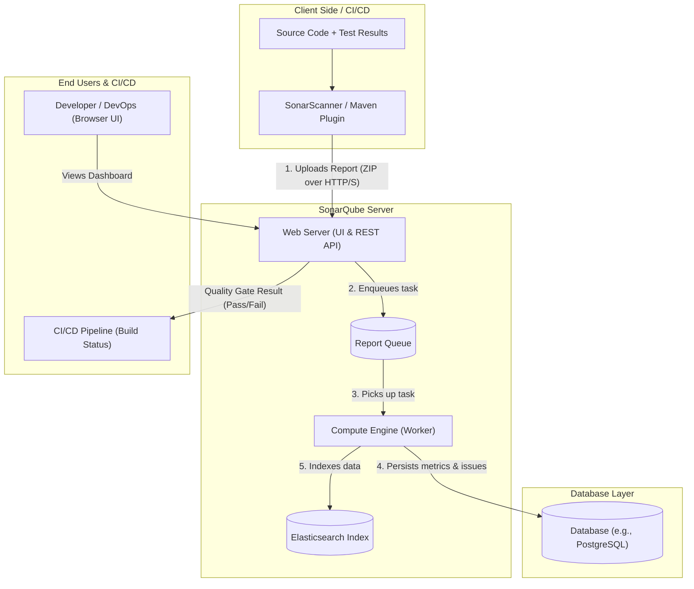

# SonarQube: Beginner-Friendly Guide & Architecture Notes

Welcome to the beginner-friendly guide to **SonarQube**! This reference covers core concepts, architecture, CI/CD integration, Docker setup, and troubleshooting tips for DevOps engineers and developers.

---

## 1. Introduction to SonarQube

### What is SonarQube?
**SonarQube** is an open-source platform designed for **Static Application Security Testing (SAST)** and continuous inspection of code quality. It analyzes source code without running it to detect bugs, security flaws, and bad programming practices.

### Why is it used?
* **Automated Code Reviews**: Automatically scans every commit and pull request.
* **Shift-Left Security**: Detects bugs and vulnerabilities early in the software development lifecycle (SDLC) before code reaches production.
* **Prevents Technical Debt**: Highlights code that is messy, hard to maintain, or overly complex.
* **Multi-Language Support**: Supports over 30 programming languages including Java, Python, JavaScript, TypeScript, C#, Go, and C++.
* **Consistency Across Teams**: Enforces shared quality standards across all projects.

---

## 2. Core Features

SonarQube evaluates code against several key categories:

| Feature | What It Means | Simple Example |
| :--- | :--- | :--- |
| **Code Quality Analysis** | Overall evaluation of code design, readability, and test coverage. | Ensuring classes and methods follow naming conventions and single-responsibility principles. |
| **Bug Detection** | Code that is demonstrably wrong and likely to cause runtime errors or crashes. | Calling a method on an object that could be `null` (`NullPointerException`), unclosed database connections. |
| **Security Vulnerabilities** | Weaknesses that make an application open to cyber attacks. | SQL Injection, Cross-Site Scripting (XSS), or using hardcoded passwords/API keys. |
| **Security Hotspots** | Security-sensitive code that requires human review to confirm whether it is safe. | Using a weak hashing algorithm (like MD5) or public IP bindings. |
| **Code Smells** | Maintainability issues that do not break functionality but make code hard to read and modify. | Duplicate code, overly long methods, high cognitive complexity, or unused variables. |
| **Code Duplication** | Blocks of identical or near-identical code copied across files. | Copy-pasting 50 lines of business logic instead of creating a reusable helper method. |

---

## 3. SonarQube Architecture

SonarQube is composed of four main components working together:

```
+-------------------------------------------------------------+
|                     1. SonarScanner                         |
|  (CLI / Maven / Gradle running on Dev Machine or CI Agent)  |
+------------------------------+------------------------------+
                               |
                   HTTP/REST   | Uploads Analysis Report
                               v
+-------------------------------------------------------------+
|                   2. SonarQube Server                       |
|                                                             |
|  +---------------------------+  +------------------------+  |
|  |     3. Web Server         |  |   4. Compute Engine    |  |
|  |  (UI, REST API, Auth)     |  |  (Processes Reports,   |  |
|  +---------------------------+  |   Calculates Metrics)  |  |
|                                 +-----------+------------+  |
+---------------------------------------------|---------------+
                                              | Reads & Writes
                                              v
+-------------------------------------------------------------+
|                      5. Database                            |
|       (PostgreSQL / MySQL / Oracle / MS SQL Server)         |
+-------------------------------------------------------------+
```

### 1. SonarScanner
* The client-side scanner installed on developer machines or CI/CD build agents (like GitHub Actions, Jenkins, GitLab CI).
* It parses source code, reads test reports, creates an analysis report, and uploads it to the SonarQube server.
* Available flavors: SonarScanner CLI, Maven plugin (`sonar-maven-plugin`), Gradle plugin, npm package.

### 2. SonarQube Server
The central management system comprising:
* **Web Server**: Provides the user interface (UI) for developers and managers, handles authentication, user permissions, project settings, and exposes REST APIs.
* **Search Server**: Built on Elasticsearch to power instant searching of issues, rules, and projects within the web interface.
* **Compute Engine (CE)**: A multi-threaded background worker that takes uploaded analysis reports, parses them, evaluates rules and Quality Gates, updates metrics, and writes the results to the database.

### 3. Database
* Stores all persistent data: project configurations, user accounts, quality metrics, issue histories, and Quality Gate definitions.
* Production databases: **PostgreSQL**, **Microsoft SQL Server**, or **Oracle**.
* *(Note: SonarQube includes an embedded H2 database solely for quick testing/evaluation; never use H2 in production).*

---

## 4. Architecture Diagram

The diagram below shows how source code is analyzed and how data moves across the system:



---

## 5. How SonarQube Works (Step-by-Step)

1. **Code Checkout & Build**: The CI/CD agent or developer checks out the code and compiles it (e.g., `mvn compile`).
2. **Execute Unit Tests**: Tests are run (e.g., `mvn test`), generating test execution and code coverage reports (e.g., JaCoCo XML).
3. **Run Scanner**: The SonarScanner parses the source code, inspects the Abstract Syntax Tree (AST), checks rules, and pairs test coverage metrics with code lines.
4. **Package & Send Report**: The scanner packages the findings into a compressed zip report and sends it to the SonarQube Server via HTTP/HTTPS.
5. **Compute Engine Processing**: The Compute Engine picks the report from the queue, runs differential calculations (focusing on new code vs. old code), and saves the results to the Database.
6. **Evaluate Quality Gate**: The Compute Engine checks if the project meets all configured conditions (e.g., 0 new bugs, >80% coverage).
7. **Feedback & Status Update**: The UI dashboard updates immediately. If the scanner was configured to wait for the Quality Gate, it informs the CI/CD pipeline whether to pass or break the build.

---

## 6. SonarQube with Maven

Maven provides official support for SonarQube via the `sonar-maven-plugin`. You do not need to install SonarScanner separately because Maven downloads and runs it automatically.

### Running Analysis from the Command Line

Navigate to your Maven project root and run:

```bash
mvn clean verify sonar:sonar \
  -Dsonar.host.url=http://localhost:9000 \
  -Dsonar.token=your_generated_sonar_token \
  -Dsonar.projectKey=task-manager \
  -Dsonar.qualitygate.wait=true
```

### Explanation of Parameters:
* `clean verify`: Cleans previous artifacts, compiles source code, runs unit tests, and verifies packaged code.
* `sonar:sonar`: Triggers the SonarQube Maven plugin to analyze code and upload reports.
* `-Dsonar.host.url`: Address of your SonarQube server (e.g., `http://localhost:9000` or `https://sonar.mycompany.com`).
* `-Dsonar.token`: Secret user or project analysis token generated in SonarQube (*User > My Account > Security*).
* `-Dsonar.projectKey`: Unique identifier for the project inside SonarQube.
* `-Dsonar.qualitygate.wait=true`: Pauses the Maven build until SonarQube finishes computing results. If the Quality Gate fails, the Maven build fails!

### Optional `pom.xml` Configuration

You can lock in the plugin version in your `pom.xml`:

```xml
<build>
    <plugins>
        <plugin>
            <groupId>org.sonarsource.scanner.maven</groupId>
            <artifactId>sonar-maven-plugin</artifactId>
            <version>3.11.0.3922</version>
        </plugin>
    </plugins>
</build>
```

---

## 7. SonarQube with GitHub Actions

Integrating SonarQube into GitHub Actions ensures that every Pull Request and branch push is scanned before merging.

### Step 1: Add Secrets in GitHub
In your GitHub repository, go to **Settings > Secrets and variables > Actions** and add:
* `SONAR_HOST_URL`: The URL of your SonarQube instance (e.g., `http://your-server-ip:9000`).
* `SONAR_TOKEN`: The authentication token created in SonarQube.

### Step 2: Create Workflow File (`.github/workflows/sonar.yml`)

```yaml
name: SonarQube Code Analysis

on:
  push:
    branches:
      - main
  pull_request:
    branches:
      - main
  workflow_dispatch:

jobs:
  sonarqube:
    name: SonarQube Scan
    runs-on: ubuntu-latest

    steps:
      - name: Checkout Source Code
        uses: actions/checkout@v4
        with:
          fetch-depth: 0 # Shallow clones disabled for accurate blame/line analysis

      - name: Set up JDK 17
        uses: actions/setup-java@v4
        with:
          distribution: 'corretto'
          java-version: '17'
          cache: 'maven'

      - name: Build, Test and Analyze with SonarQube
        env:
          SONAR_TOKEN: ${{ secrets.SONAR_TOKEN }}
          SONAR_HOST_URL: ${{ secrets.SONAR_HOST_URL }}
        run: |
          mvn --batch-mode verify sonar:sonar \
            -Dsonar.projectKey=task-manager \
            -Dsonar.qualitygate.wait=true \
            -Dsonar.qualitygate.timeout=300
```

### Why this is powerful in CI/CD:
* If a developer introduces a new critical bug or security flaw, the Quality Gate fails.
* The GitHub Actions build turns **RED** (fails).
* Merging into `main` can be blocked until the code is fixed!

---

## 8. What is a Quality Gate?

A **Quality Gate** is a set of threshold conditions that code must pass before it can be released or merged into production. Think of it as a **go/no-go quality check**.

### How It Works: "Clean as You Code"
SonarQube emphasizes the **Clean as You Code** philosophy. Instead of worrying about fixing thousands of historical legacy issues all at once, focus on ensuring that **all newly written or edited code meets high standards**.

### Common Default Conditions (Sonar way):
* **0 New Bugs**: No new bugs introduced.
* **0 New Vulnerabilities**: No new security flaws introduced.
* **0 Security Hotspots Unreviewed**: All new potential hotspots must be audited.
* **Test Coverage on New Code >= 80%**: At least 80% of new code lines must be covered by unit tests.
* **Duplicated Lines on New Code <= 3%**: Less than 3% duplication on new code.

### Statuses:
* 🟢 **PASSED**: Code meets all requirements and is safe to merge/deploy.
* 🔴 **FAILED**: Code violated one or more conditions (e.g., test coverage is 65% instead of 80%).

---

## 9. Docker Installation

Docker is the quickest way to get SonarQube running locally or on a cloud virtual machine.

### 1. Run SonarQube in a Container

#### Quick run (testing only):
```bash
docker run -d --name sonarqube -p 9000:9000 sonarqube:lts-community
```

#### Recommended run (with persistent data storage):
```bash
docker run -d \
  --name sonarqube \
  -p 9000:9000 \
  -v sonarqube_data:/opt/sonarqube/data \
  -v sonarqube_logs:/opt/sonarqube/logs \
  -v sonarqube_extensions:/opt/sonarqube/extensions \
  sonarqube:lts-community
```

### 2. Check Container Status
```bash
docker ps
```
Look for `sonarqube` with status `Up` and port mapping `0.0.0.0:9000->9000/tcp`.

### 3. View Live Logs
```bash
docker logs -f sonarqube
```
Wait until you see: `SonarQube is operational`.

### 4. Stop the Container
```bash
docker stop sonarqube
```

### 5. Restart or Remove the Container
```bash
# Start an existing stopped container
docker start sonarqube

# Restart container
docker restart sonarqube

# Remove container
docker rm -f sonarqube
```

### 6. First Login:
* **URL**: `http://localhost:9000`
* **Default Username**: `admin`
* **Default Password**: `admin`
*(You will be prompted to choose a new password immediately upon first login).*

---

## 10. Useful Commands & Troubleshooting

### Check SonarQube Health via REST API
Quickly verify if SonarQube is up and running using `curl`:
```bash
curl -s http://localhost:9000/api/system/status
```
Expected output:
```json
{"id":"...","version":"...","status":"UP"}
```
*(Possible statuses: `STARTING`, `UP`, `RESTARTING`, `DOWN`).*

---

### Common Issues & Quick Fixes

#### Issue 1: Container Exits Immediately with Elasticsearch Error (`max virtual memory areas vm.max_map_count [65530] is too low`)
* **Cause**: The bundled Elasticsearch requires higher virtual memory map counts on Linux.
* **Fix**: Run this command on your host machine:
  ```bash
  sudo sysctl -w vm.max_map_count=262144
  ```
  To make it permanent, add `vm.max_map_count=262144` to `/etc/sysctl.conf`.

#### Issue 2: SonarQube Takes Long to Start or Runs Out of Memory
* **Cause**: SonarQube requires at least **2GB to 4GB of free RAM**.
* **Fix**: Ensure your Docker engine has allocated at least 4GB of RAM (Docker Desktop > Settings > Resources > Memory).

#### Issue 3: Port 9000 is Already in Use
* **Cause**: Another service or process is using port 9000.
* **Fix**:
  * Check what process is using port 9000:
    ```bash
    # On macOS / Linux
    lsof -i :9000
    ```
  * Map SonarQube to a different host port (e.g. 9001):
    ```bash
    docker run -d --name sonarqube -p 9001:9000 sonarqube:lts-community
    ```

#### Issue 4: `qualitygate.wait` Times Out in CI/CD
* **Cause**: Large projects or overloaded SonarQube servers take longer than default timeout to compute reports.
* **Fix**: Increase the timeout parameter in Maven command:
  ```bash
  -Dsonar.qualitygate.wait=true -Dsonar.qualitygate.timeout=600
  ```

---

## Quick Summary Cheat Sheet

| Task | Command |
| :--- | :--- |
| **Run SonarQube with Docker** | `docker run -d --name sonarqube -p 9000:9000 sonarqube:lts-community` |
| **Check SonarQube Logs** | `docker logs -f sonarqube` |
| **Check System Status** | `curl http://localhost:9000/api/system/status` |
| **Scan Java Project (Maven)** | `mvn clean verify sonar:sonar -Dsonar.host.url=... -Dsonar.token=...` |
| **Enforce Quality Gate in Build** | `-Dsonar.qualitygate.wait=true` |
